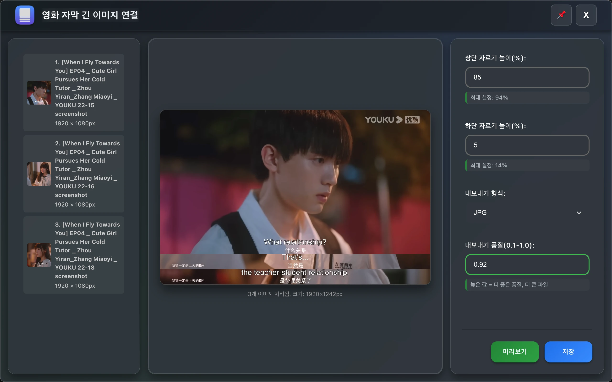
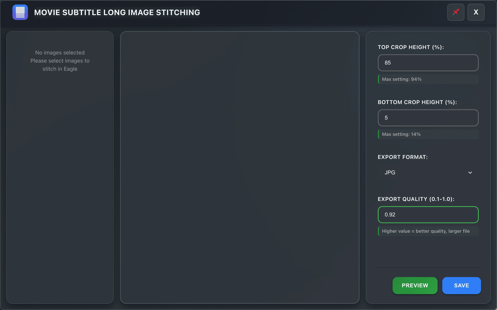
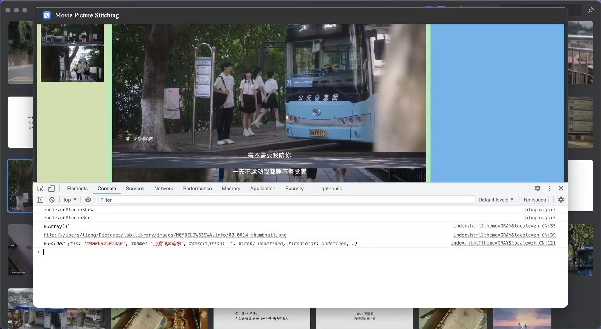
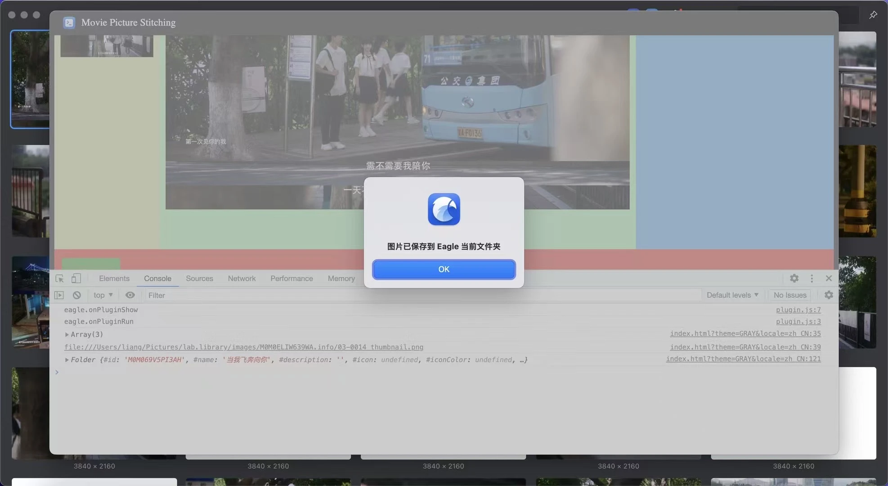
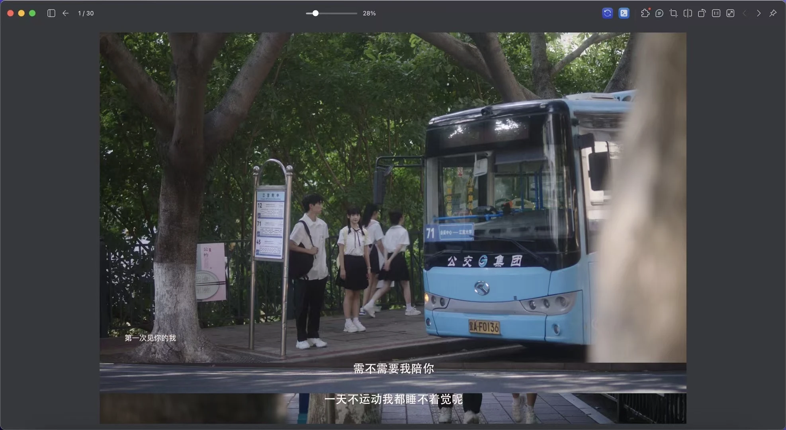

# Changelog

All notable changes to this project will be documented in this file.

The format is based on [Keep a Changelog](https://keepachangelog.com/en/1.0.0/),
and this project adheres to [Semantic Versioning](https://semver.org/spec/v2.0.0.html).

## [Unreleased]

## [3.0.0] - 2025-01-XX 🚀 MAJOR REWRITE

### Complete React + TypeScript Migration

#### ✨ Added
- 🚀 **Complete React Rewrite**: Full migration to React 18.3 + TypeScript 5.6
  - Modern component-based architecture with hooks
  - Type-safe development with full IntelliSense support
  - Improved code maintainability and developer experience
- 🎨 **Modern UI Stack**:
  - **Tailwind CSS 3**: Utility-first styling with Eagle-specific design tokens
  - **Radix UI**: Accessible, unstyled component primitives (Dialog, Slider, Select, etc.)
  - **Lucide Icons**: Beautiful, consistent iconography throughout the interface
  - **class-variance-authority (CVA)**: Type-safe component variants
- 🛠️ **Build System**:
  - **Vite 5**: Lightning-fast HMR and optimized production builds
  - Browser-based development with mocked Eagle API
  - Hot module replacement for instant feedback
- 📦 **State Management**:
  - **Zustand 5**: Lightweight, performant state management
  - Feature-based state slices for better organization
  - Optimized re-renders with selectors
- ✨ **New Features**:
  - **Auto-Preview**: Automatically updates preview when images are reordered or parameters change
  - **Keyboard Shortcuts**: Full keyboard navigation support
    - `Cmd/Ctrl + Enter`: Generate preview
    - `Cmd/Ctrl + S`: Save image
    - `Cmd/Ctrl + H`: Show keyboard shortcuts help
    - `Cmd/Ctrl + 1/2`: Focus crop input fields
  - **Lightbox Viewer**: Full-screen image viewer with zoom and pan controls
  - **Drag & Drop Reordering**: Intuitive image order management in the left panel
  - **Enhanced Parameter Persistence**: Settings automatically saved across sessions
- 🧪 **Testing Infrastructure**:
  - **Vitest**: Fast unit testing framework
  - **Playwright**: End-to-end and visual regression testing
  - Comprehensive test coverage for core functionality
- 🌍 **Internationalization**:
  - **i18next + react-i18next**: Industry-standard i18n with React bindings
  - Maintained 8-language support (en, zh_CN, zh_TW, ja_JP, ko_KR, de_DE, es_ES, ru_RU)
  - Enhanced translation system with React hooks

#### 🚚 Changed
- **Architecture**: Complete rewrite from Bootstrap 5 + Vanilla JS to React + TypeScript
- **Project Structure**: New `Movie Picture Stitching React/` directory with modern React structure
  - `src/` directory with organized components, hooks, stores, and utilities
  - Component-based file organization
  - Separation of concerns (UI, logic, state, API)
- **Development Workflow**:
  - Browser-based development with mocked Eagle API (no Eagle required for development)
  - Hot module replacement for instant feedback
  - TypeScript strict mode for better type safety
  - ESLint + Prettier for code quality
- **UI Components**:
  - Replaced emoji icons with Lucide React icons for consistency
  - Enhanced accessibility with Radix UI primitives
  - Improved dark mode support with Tailwind CSS
  - Better responsive design with Tailwind utilities
- **State Management**: Migrated from event-driven CustomEvents to Zustand store
- **API Access**: Introduced `eagleApi` adapter for safe API access in both browser and Eagle environments

#### 🐛 Fixed
- 🔧 **Preview Display**: Fixed preview image not displaying initially
  - Switched from direct canvas DOM manipulation to `` tag rendering
  - Improved CSS scaling and responsive behavior
- 🔧 **Lightbox Issues**: Fixed lightbox not showing image on initial open
  - Proper zoom and offset reset on lightbox open
  - Correct initial "fit" zoom calculation
- 🔧 **Auto-Preview**: Fixed auto-preview not updating when images are reordered
  - Added debounced preview updates on image order changes
  - Proper tracking of image order changes
- 🔧 **Keyboard Shortcuts**:
  - Fixed help shortcut conflict with Eagle's native shortcut (changed from `Cmd/Ctrl + Shift + /` to `Cmd/Ctrl + H`)
  - Fixed focus crop input shortcuts (`Cmd/Ctrl + 1/2`) not working
  - Proper ref forwarding through component hierarchy
- 🔧 **Help Dialog**: Fixed unresponsive help icon in page header
  - Proper state management for shortcuts dialog
  - Correct event handling

#### 🗑️ Removed
- Bootstrap 5 dependency (replaced with Tailwind CSS)
- Vanilla JavaScript modules (replaced with React components)
- Direct DOM manipulation patterns (replaced with React state and refs)
- Custom event system (replaced with Zustand state management)

#### 🧭 Developer Notes / Migration
- **BREAKING**: Complete architectural change - this is a major rewrite
- **New Development Setup Required**:
  - Node.js 18+ and npm/yarn/pnpm required
  - Run `npm install` in `Movie Picture Stitching React/` directory
  - Use `npm run dev` for browser-based development
  - Use `npm run build` to build for production
- **API Access Pattern**:
  - Always use `eagleApi` singleton from `@/lib/eagle-api`
  - Never access `window.eagle` directly
  - Works identically in browser (mocked) and Eagle (real API)
- **Component Development**:
  - Use React hooks for state and side effects
  - Use Zustand for global state management
  - Use Tailwind CSS utilities for styling
  - Follow TypeScript strict mode guidelines
- **Key Files to Inspect**:
  - `src/pages/StitchingPage.tsx`: Main application page
  - `src/components/stitching/*`: Stitching-specific components
  - `src/stores/slices/*`: Zustand state slices
  - `src/hooks/*`: Custom React hooks
  - `src/lib/eagle-api.ts`: Eagle API adapter
  - `vite.config.ts`: Build configuration
  - `tailwind.config.js`: Tailwind CSS configuration

#### 📝 Documentation
- README.md and README.zh-TW.md completely updated for React architecture
- Added development workflow documentation
- Added React component examples
- Updated project structure documentation
- Added keyboard shortcuts documentation

#### 🔧 Technical Details
- **New Dependencies**:
  - `react@^18.3.1`, `react-dom@^18.3.1`
  - `typescript@^5.6.3`
  - `vite@^5.4.10`
  - `tailwindcss@^3.4.14`
  - `zustand@^5.0.9`
  - `@radix-ui/*`: Multiple Radix UI components
  - `lucide-react@^0.460.0`
  - `i18next@^23.16.4`, `react-i18next@^15.1.1`
- **Build Output**: Optimized bundle in `dist/` directory
- **Type Safety**: Full TypeScript coverage with strict mode
- **Code Quality**: ESLint + Prettier + TypeScript compiler checks

---

## [2.0.0] - 2025-11-01 🚧 BREAKING

### Merged: `reconstruct/bootstrap5` → `main`

#### ✨ Added
- Bootstrap 5 UI rewrite: plugin UI rebuilt using Bootstrap 5 utilities and a design-token-based `css/bootstrap-config.css`.
- `vendor/bootstrap-5.3.8/` assets added to the repository for offline usage.
- `js/plugin-modular.js` introduced as the main orchestrator (replaces older `plugin.js` entry in the UI flow).

#### 🚚 Changed
- Modularized CSS layout: theme overrides moved to `css/components/*`, utilities to `css/utilities/*`, animations to `css/modules/`.
- `index.html` load order updated to: Bootstrap → `bootstrap-config.css` → component CSS → utilities → modules.
- Event-driven module wiring: modules communicate via window CustomEvents (eg. `eagle:selectionChanged`, `ui:parameterChanged`).
- Storage & parameter persistence retained and integrated with new UI (namespaced keys: `eagle-movie-stitching:<name>`).

#### 🧭 Developer notes / migration
- BREAKING: UI DOM structure and CSS tokens changed. Update any custom themes or automations that reference old selectors.
- ALWAYS check `typeof eagle !== 'undefined'` before using Eagle API (polling pattern remains 500ms in `js/modules/eagle-api-manager.js`).
- Canvas hard limit unchanged: validate canvas dimensions against 32767px before rendering.
- Dev workflow unchanged: copy `Movie Picture Stitching` folder to Eagle plugins dir to test; no build step required.
- Key files to inspect after the merge: `index.html`, `css/bootstrap-config.css`, `css/components/*`, `js/plugin-modular.js`, `js/modules/*`, `_locales/*`.

#### 📝 Documentation
- README updated to reflect Bootstrap 5 migration and the new CSS/module layout.

## [1.0.1] - 2025-10-30 💾

### ✨ Added
- 💾 **Parameter Persistence**: Automatically saves and restores user settings
  - Crop percentages (top and bottom)
  - Export format (JPG, PNG, WebP)
  - Export quality (0.1-1.0)
  - Settings persist across plugin sessions using localStorage
  - No manual save/load required - completely automatic
  - Auto-save with 300ms debounce prevents excessive writes
- 🔧 **Storage Manager Module**: New modular storage system with localStorage
  - Robust validation and error handling
  - Graceful degradation when storage unavailable
  - Debug utilities for development (`storageDebug.*` console commands)
  - Namespaced storage keys for data isolation

### 🚀 Improved
- ⚡ **Performance**: Instant plugin load time
  - Fixed critical 5-second delay on plugin open
  - Optimized initialization sequence - DOM operations deferred
  - Plugin now opens instantly (< 200ms)
  - Parameters load and apply synchronously after DOM ready
- 🎯 **User Experience**: Seamless parameter restoration
  - Settings automatically restored on plugin reopen
  - No need to reconfigure parameters every session
  - Smooth, non-blocking initialization
- 🛡️ **Data Safety**: Comprehensive validation before saving/loading parameters
  - Parameter validation prevents invalid values
  - Safe fallback to defaults on load errors

### 🐛 Fixed
- 🔧 Fixed incorrect DOM element IDs causing parameters not to apply
- 🔧 Removed duplicate `getParams()` method definition
- ⚡ Eliminated blocking DOM wait in constructor
- 🚀 Separated initialization logic to prevent UI freeze on plugin open

### 🔧 Technical Changes
- **New Files**:
  - `js/modules/storage-manager.js`: localStorage abstraction layer
- **Modified Files**:
  - `js/modules/parameter-manager.js`: Added storage integration and initialize() method
  - `js/plugin-modular.js`: Updated initialization sequence
  - `index.html`: Added storage-manager.js script
- **New Methods**:
  - `ParameterManager.initialize()`: Apply saved parameters after DOM ready
  - `ParameterManager.applyParametersToDOMSync()`: Synchronous DOM updates
  - `ParameterManager.saveCurrentParameters()`: Debounced auto-save
  - `StorageManager.*`: Complete storage abstraction API
- **Debug Tools**:
  - `storageDebug.viewAll()`: View all saved parameters
  - `storageDebug.clearAll()`: Clear all saved parameters
  - `storageDebug.resetDefaults()`: Reset to default values
  - `storageDebug.testCycle()`: Test save/load cycle

### 📚 Documentation
- Added comprehensive technical documentation
- Created testing guides and troubleshooting steps
- Updated code comments and JSDoc

## [1.0.0] - 2025-09-01 🌍

### ✨ Added
- 🌍 **Complete Internationalization System**: Full 8-language support
  - English, 简体中文, 繁體中文, 日本語, Español, Deutsch, 한국어, Русский
  - Automatic language detection based on Eagle settings
  - Real-time language switching without restart
  - Comprehensive UI element localization
- 🔧 **Enhanced Error Handling**: Multilingual error messages and user feedback
- 📚 **Comprehensive Documentation**: Full English code comments and JSDoc
- 🎯 **Language-Specific Features**: Cultural formatting for numbers and dates
- 🔄 **Dynamic Translation System**: Real-time content translation

### 🚀 Improved  
- 🎨 **UI Accessibility**: Better accessibility and language-specific formatting
- 📱 **Cross-Language UX**: Consistent user experience across all supported languages
- 🔧 **Error Messages**: Localized error handling with culturally appropriate feedback
- 📖 **Code Quality**: Comprehensive English comments replacing Chinese comments
- 🌐 **International Standards**: Adherence to international coding standards

### 🔧 Technical Improvements
- 📁 **File Structure**: Added `_locales/` directory with 8 language files
- 🧩 **Modular Architecture**: Separation of i18n logic from core functionality  
- ⚡ **Performance**: Optimized language switching and translation caching
- 🛡️ **Fallback System**: Graceful fallback to English for missing translations

---

## [0.0.0] - 2024-10 self-use UI backup

---

## Versioning

This project follows [Semantic Versioning](https://semver.org/) guidelines:

- **Major Version**: Incompatible API changes
- **Minor Version**: Backward-compatible functionality additions
- **Patch Version**: Backward-compatible bug fixes

## Release Process

1. Update version number in `manifest.json`
2. Update this CHANGELOG.md file  
3. Create Git tag
4. Build release package
5. Submit to Eagle Plugin Store

## Feedback & Support

If you encounter any issues or have feature suggestions, please reach out:

- **GitHub Issues**: [Issues](https://github.com/leonwong282/eagle-movie-picture-stitching/issues)
- **Feature Requests**: [Discussions](https://github.com/leonwong282/eagle-movie-picture-stitching/discussions)
- **Documentation**: [Wiki](https://github.com/leonwong282/eagle-movie-picture-stitching/wiki)
- **Email**: liangwatcher82@gmail.com

---

**Made with ❤️ for the Eagle community**

*Supporting international users with comprehensive multilingual support*

