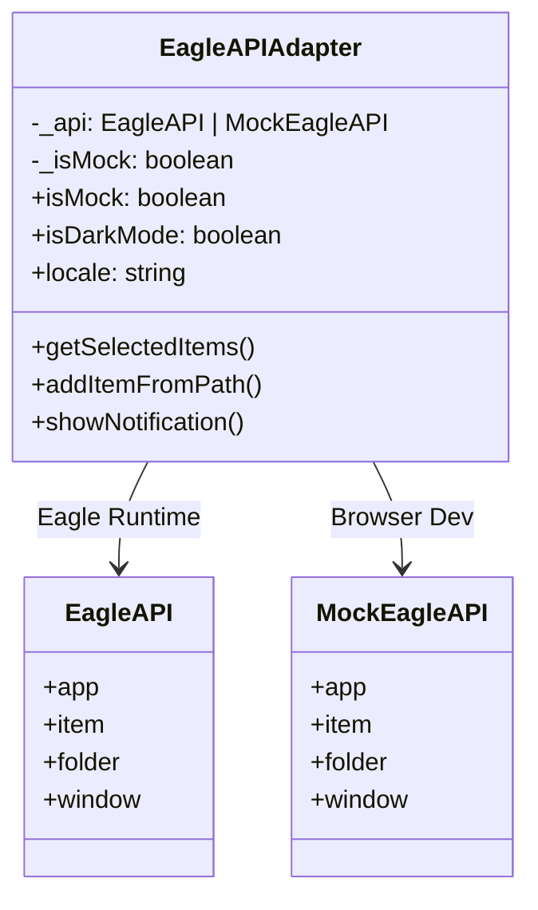

# Eagle API Adapter

The `EagleAPIAdapter` class is the heart of the dual environment pattern. It provides a type-safe, unified interface that works identically in browser and Eagle.

## Overview

```typescript
import { eagleApi, isEagleEnvironment } from '@/lib/eagle-api';

// Single import, works everywhere
const items = await eagleApi.getSelectedItems();
const isDark = eagleApi.isDarkMode;
const locale = eagleApi.locale;
```

## Architecture



## Implementation Details

### Constructor Pattern

The adapter detects the environment at instantiation:

```typescript
class EagleAPIAdapter {
  private _api: EagleAPI | Partial<EagleAPI>;
  private _isMock: boolean;

  constructor() {
    if (isEagleEnvironment()) {
      // Real Eagle API
      this._api = (window as EagleWindow).eagle;
      this._isMock = false;
    } else {
      // Mock API for browser development
      this._api = createMockEagleAPI();
      this._isMock = true;
    }
  }
}
```

### Safe Property Getters

Properties use try-catch to handle the `plugin-create` timing issue:

```typescript
// Eagle API may not be fully initialized until plugin-create event
get locale(): EagleLocale {
  try {
    return this._api.app?.locale || 'en';
  } catch {
    return 'en'; // Safe default
  }
}

get isDarkMode(): boolean {
  try {
    const darkThemes: EagleTheme[] = ['DARK', 'GRAY', 'BLUE', 'PURPLE'];
    if (this._api.app?.theme === 'Auto') {
      return this._api.app.isDarkColors?.() ?? false;
    }
    return darkThemes.includes(this._api.app.theme);
  } catch {
    // Fallback to system preference
    return window.matchMedia('(prefers-color-scheme: dark)').matches;
  }
}
```

:::tip Why Try-Catch?
Eagle's API properties may throw errors if accessed before the `plugin-create` event fires. The try-catch pattern ensures your app can safely initialize i18n and themes during module load.
:::

## API Reference

### Properties

| Property | Type | Description |
|----------|------|-------------|
| `isMock` | `boolean` | `true` in browser, `false` in Eagle |
| `isDarkMode` | `boolean` | Current theme darkness |
| `locale` | `EagleLocale` | Current language code |
| `platform` | `string` | `'darwin'` or `'win32'` |
| `isMac` | `boolean` | Running on macOS |
| `isWindows` | `boolean` | Running on Windows |
| `version` | `string` | Eagle version (e.g., `'4.0.0'`) |
| `build` | `number` | Eagle build number |

### Item Operations

```typescript
// Get selected items
const items = await eagleApi.getSelectedItems();

// Get all items in library
const allItems = await eagleApi.getAllItems();

// Get item by ID
const item = await eagleApi.getItemById('item-id');

// Add new item to library
await eagleApi.addItemFromPath('/path/to/image.png', {
  name: 'My Image',
  tags: ['processed', 'exported'],
  annotation: 'Created by my plugin',
  folders: ['folder-id'],
});

// Add from URL
await eagleApi.addItemFromURL('https://example.com/image.jpg', {
  name: 'Downloaded Image',
});
```

### Folder Operations

```typescript
// Get all folders
const folders = await eagleApi.getAllFolders();

// Get selected folders
const selected = await eagleApi.getSelectedFolders();

// Get folder by ID
const folder = await eagleApi.getFolderById('folder-id');

// Create new folder
await eagleApi.createFolder({
  name: 'New Folder',
  parent: 'parent-folder-id', // optional
});
```

### Window Controls

```typescript
// Keep window on top
await eagleApi.setAlwaysOnTop(true);

// Resize window
await eagleApi.setWindowSize(1200, 800);

// Get window bounds
const bounds = await eagleApi.getWindowBounds();
```

### Dialogs

```typescript
// Open file dialog
const result = await eagleApi.showOpenDialog({
  properties: ['openFile', 'multiSelections'],
  filters: [
    { name: 'Images', extensions: ['png', 'jpg', 'webp'] },
    { name: 'All Files', extensions: ['*'] },
  ],
});

// Save file dialog
const savePath = await eagleApi.showSaveDialog({
  defaultPath: 'output.png',
  filters: [{ name: 'PNG Image', extensions: ['png'] }],
});

// Message box
await eagleApi.showMessageBox({
  type: 'info',
  title: 'Success',
  message: 'Operation completed!',
  buttons: ['OK'],
});
```

### Notifications

```typescript
// Show notification
await eagleApi.showNotification('Title', 'Message body');
```

### Shell Operations

```typescript
// Open URL in default browser
await eagleApi.openExternal('https://eagle.cool');

// Show file in Finder/Explorer
await eagleApi.showItemInFolder('/path/to/file.png');

// Open file with default app
await eagleApi.openPath('/path/to/file.png');
```

### Logging

```typescript
// Writes to Eagle's log file in production
eagleApi.log.info('Processing started');
eagleApi.log.warn('Quality is below recommended');
eagleApi.log.error('Failed to save file');
```

## Usage Patterns

### Async/Await Pattern

```tsx
async function processSelection() {
  try {
    const items = await eagleApi.getSelectedItems();
    
    for (const item of items) {
      // Process each item
      await processItem(item);
    }
    
    await eagleApi.showNotification('Done', `Processed ${items.length} items`);
  } catch (error) {
    eagleApi.log.error(`Processing failed: ${error.message}`);
  }
}
```

### With React Hooks

```tsx
import { useEffect, useState } from 'react';
import { eagleApi } from '@/lib/eagle-api';

function useEagleItems() {
  const [items, setItems] = useState([]);
  const [loading, setLoading] = useState(true);

  useEffect(() => {
    eagleApi.getSelectedItems()
      .then(setItems)
      .finally(() => setLoading(false));
  }, []);

  return { items, loading };
}
```

### Conditional Rendering

```tsx
import { eagleApi } from '@/lib/eagle-api';

function FeatureGate({ children, fallback }) {
  if (eagleApi.isMock) {
    return fallback || <MockDataBanner />;
  }
  return children;
}

// Usage
<FeatureGate fallback={<p>This feature requires Eagle</p>}>
  <RealExportButton />
</FeatureGate>
```

## Singleton Export

The adapter is exported as a singleton:

```typescript
// src/lib/eagle-api.ts
export const eagleApi = new EagleAPIAdapter();
```

This ensures:
- **Single instance** — No duplicate API connections
- **Consistent state** — Same mock config everywhere
- **Tree-shakeable** — Import only what you use

## Type Safety

Full TypeScript support with complete Eagle API types:

```typescript
import { eagleApi } from '@/lib/eagle-api';
import type { Item, Folder, EagleLocale } from '@/types/eagle';

// Type-safe item access
const items: Item[] = await eagleApi.getSelectedItems();
const firstItem = items[0];

console.log(firstItem.id);        // string
console.log(firstItem.name);      // string
console.log(firstItem.tags);      // string[]
console.log(firstItem.filePath);  // string
```

## Next Steps

- **[Mock System](./mock-system)** — Configure mock data for testing
- **[Theme & i18n](./theme-i18n)** — Sync with Eagle's settings
- **[Eagle API Reference](/docs/eagle-api/overview)** — Complete API documentation
