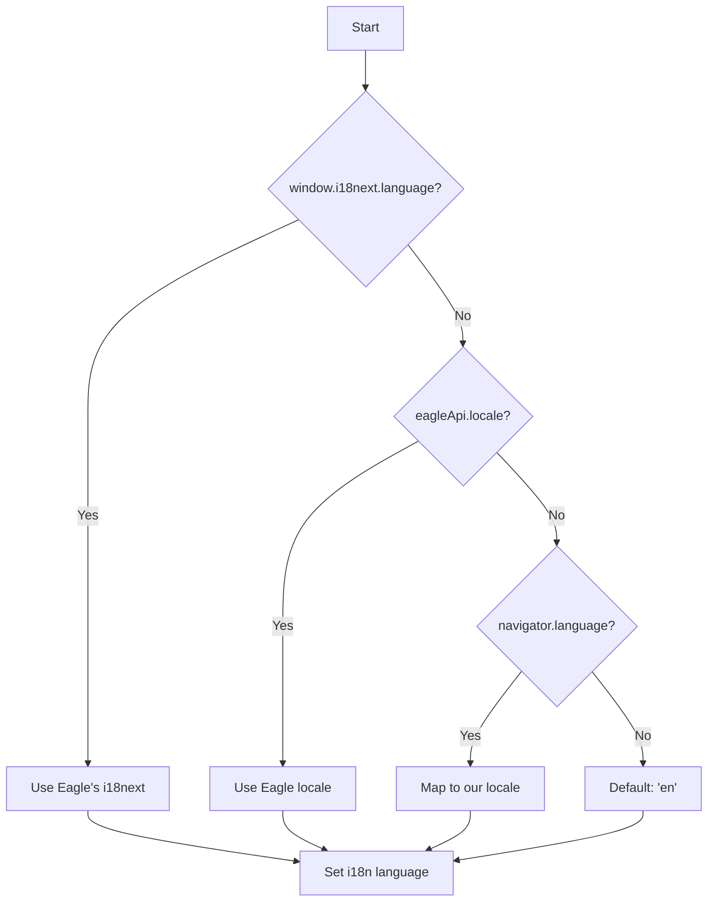

# Theme & i18n

The template automatically syncs with Eagle's theme and language settings, providing a native feel while maintaining full browser development support.

## Theme System

### Eagle Themes

Eagle supports these theme modes:

| Theme | Darkness | Description |
|-------|----------|-------------|
| `DARK` | Dark | Pure dark theme |
| `LIGHT` | Light | Pure light theme |
| `GRAY` | Dark | Dark gray theme |
| `BLUE` | Dark | Dark blue accent |
| `PURPLE` | Dark | Dark purple accent |
| `Auto` | Varies | Follows system preference |

### Theme Detection

The `eagleApi.isDarkMode` property computes the current darkness:

```typescript
import { eagleApi } from '@/lib/eagle-api';

// In Eagle: Computed from Eagle's theme setting
// In Browser: Uses system preference or localStorage

if (eagleApi.isDarkMode) {
  // Apply dark styles
}
```

### Implementation

```typescript
// src/lib/eagle-api.ts
get isDarkMode(): boolean {
  try {
    const darkThemes: EagleTheme[] = ['DARK', 'GRAY', 'BLUE', 'PURPLE'];
    
    if (this._api.app?.theme === 'Auto') {
      // Use Eagle's computed value for Auto
      return this._api.app.isDarkColors?.() ?? false;
    }
    
    return darkThemes.includes(this._api.app.theme);
  } catch {
    // Fallback to system preference
    return window.matchMedia('(prefers-color-scheme: dark)').matches;
  }
}
```

### useTheme Hook

For React components, use the `useTheme` hook:

```tsx
import { useTheme } from '@/hooks';

function ThemeToggle() {
  const { theme, isDarkMode, setTheme, toggleTheme } = useTheme();

  return (
    <div>
      <p>Current: {theme} ({isDarkMode ? 'dark' : 'light'})</p>
      
      <button onClick={toggleTheme}>
        Toggle Theme
      </button>
      
      <select value={theme} onChange={(e) => setTheme(e.target.value)}>
        <option value="auto">Auto</option>
        <option value="light">Light</option>
        <option value="dark">Dark</option>
      </select>
    </div>
  );
}
```

### Theme Persistence

The hook stores the user's preference in localStorage:

```typescript
// Storage key: 'eagle-react-template:theme'

// Automatic sync:
// 1. Check localStorage for saved preference
// 2. Apply 'dark' class to <html> element
// 3. Listen for system preference changes
```

### Tailwind Integration

The template uses Tailwind's dark mode with the `class` strategy:

```javascript
// tailwind.config.js
module.exports = {
  darkMode: 'class',
  // ...
};
```

Use dark mode classes in your components:

```tsx
<div className="bg-white dark:bg-gray-900">
  <p className="text-gray-900 dark:text-gray-100">
    Adapts to theme automatically
  </p>
</div>
```

### CSS Variables

Eagle-specific design tokens in `globals.css`:

```css
:root {
  /* Light theme */
  --eagle-bg-primary: #ffffff;
  --eagle-text-primary: #1a1a1a;
  --eagle-accent-primary: #238636;
}

.dark {
  /* Dark theme */
  --eagle-bg-primary: #0d1117;
  --eagle-text-primary: #c9d1d9;
  --eagle-accent-primary: #238636;
}
```

## Internationalization (i18n)

### 8-Language Support

Pre-configured translations:

| Code | Language |
|------|----------|
| `en` | English (fallback) |
| `zh_CN` | Simplified Chinese |
| `zh_TW` | Traditional Chinese |
| `ja_JP` | Japanese |
| `ko_KR` | Korean |
| `de_DE` | German |
| `es_ES` | Spanish |
| `ru_RU` | Russian |

### Language Detection Flow



### Using Translations

```tsx
import { useTranslation } from 'react-i18next';

function MyComponent() {
  const { t } = useTranslation();

  return (
    <div>
      <h1>{t('app.title')}</h1>
      <p>{t('demo.selectedCount', { count: 5 })}</p>
    </div>
  );
}
```

### Translation File Structure

`_locales/en.json`:

```json
{
  "manifest": {
    "app": {
      "name": "Eagle React Template",
      "description": "Modern React template for Eagle plugins"
    }
  },
  "app": {
    "title": "Eagle React Template",
    "loading": "Loading..."
  },
  "demo": {
    "tabs": {
      "selection": "Selection",
      "components": "Components"
    },
    "selectedCount": "{{count}} items selected",
    "noSelection": "No items selected"
  },
  "common": {
    "save": "Save",
    "cancel": "Cancel",
    "confirm": "Confirm"
  }
}
```

### Pluralization

i18next handles plurals automatically:

```json
{
  "item": "{{count}} item",
  "item_plural": "{{count}} items"
}
```

```tsx
t('item', { count: 1 });  // "1 item"
t('item', { count: 5 });  // "5 items"
```

### useLanguageSync Hook

Automatically syncs with Eagle's language changes:

```tsx
import { useLanguageSync } from '@/hooks';

function App() {
  // Syncs when:
  // - Plugin becomes visible
  // - Eagle language changes
  // - html[lang] attribute changes
  useLanguageSync();

  return <MyApp />;
}
```

### Language Change Events

The hook listens for multiple events:

```typescript
// Events monitored:
// 1. visibilitychange - When plugin tab becomes visible
// 2. MutationObserver on html[lang] - When Eagle changes language
// 3. Fallback polling - Every 10 seconds (if other methods fail)
```

### Adding a New Language

1. **Create translation file**:

```bash
cp _locales/en.json _locales/fr_FR.json
```

2. **Translate all keys**:

```json
{
  "app": {
    "title": "Modèle Eagle React"
  }
}
```

3. **Add to manifest.json**:

```json
{
  "languages": ["en", "zh_CN", "zh_TW", "ja_JP", "ko_KR", "de_DE", "es_ES", "ru_RU", "fr_FR"],
  "fallbackLanguage": "en"
}
```

4. **Add to i18n config**:

```typescript
// src/lib/i18n.ts
import fr_FR from '@locales/fr_FR.json';

const resources = {
  // ...existing
  fr_FR: { translation: fr_FR },
};
```

## Browser vs Eagle Behavior

| Aspect | Browser | Eagle |
|--------|---------|-------|
| **Theme** | System preference / localStorage | Eagle's theme setting |
| **Language** | navigator.language / localStorage | Eagle's locale |
| **Theme changes** | Listen to `prefers-color-scheme` | Listen to Eagle events |
| **Language changes** | Manual only | Auto-sync with Eagle |

## Best Practices

### 1. Always Use Translation Keys

```tsx
// ❌ Hardcoded text
<button>Save</button>

// ✅ Translation key
<button>{t('common.save')}</button>
```

### 2. Use Semantic Color Classes

```tsx
// ❌ Fixed colors
<div className="bg-gray-900 text-white">

// ✅ Semantic / dark mode aware
<div className="bg-background text-foreground">
<div className="bg-white dark:bg-gray-900">
```

### 3. Handle Missing Translations

```tsx
// i18next returns the key if translation is missing
// Set up fallback behavior in i18n config

i18n.init({
  fallbackLng: 'en',
  interpolation: {
    escapeValue: false, // React already escapes
  },
});
```

### 4. Test Multiple Locales

```javascript
// In browser console
window.mockEagle.setConfig({ locale: 'ja_JP' });
location.reload();
```

## Next Steps

- **[Components](/docs/components/overview)** — UI component library
- **[Hooks](/docs/hooks/overview)** — Custom React hooks
