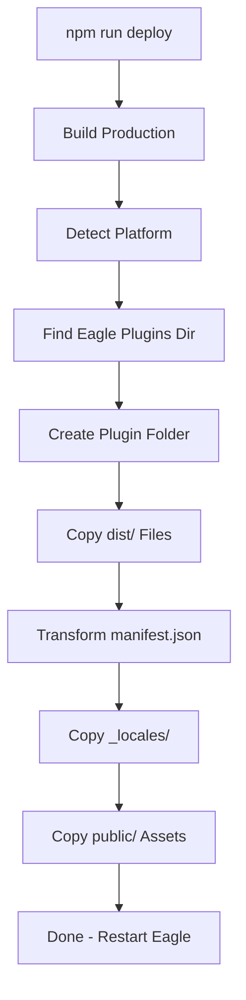

# Deploy Script

The deploy script automates the process of building and installing your plugin to Eagle's plugins directory. It handles platform detection, path transformation, and file copying.

## Quick Usage

```bash
# Build and deploy to Eagle
npm run deploy
```

After deployment, **restart Eagle** to load the updated plugin.

## How It Works

The deploy script (`scripts/deploy.js`) performs these steps:



## Platform Paths

Eagle stores plugins in platform-specific directories:

| Platform | Plugins Directory |
|----------|-------------------|
| **macOS** | `~/Library/Application Support/Eagle/plugins/` |
| **Windows** | `%APPDATA%\Eagle\plugins\` |

The script automatically detects the current platform and uses the appropriate path.

## Script Implementation

```javascript title="scripts/deploy.js"
#!/usr/bin/env node

import { execSync } from 'child_process';
import { cpSync, existsSync, mkdirSync, readFileSync, writeFileSync } from 'fs';
import { homedir } from 'os';
import { join, dirname } from 'path';
import { fileURLToPath } from 'url';

const __filename = fileURLToPath(import.meta.url);
const __dirname = dirname(__filename);
const ROOT_DIR = join(__dirname, '..');

// Get Eagle plugins directory based on platform
function getEaglePluginsDir() {
  const home = homedir();
  
  switch (process.platform) {
    case 'darwin':
      return join(home, 'Library', 'Application Support', 'Eagle', 'plugins');
    case 'win32':
      return join(process.env.APPDATA || join(home, 'AppData', 'Roaming'), 'Eagle', 'plugins');
    default:
      throw new Error(`Unsupported platform: ${process.platform}`);
  }
}

// Transform manifest paths for deployment
function transformManifest(manifest) {
  const transformed = { ...manifest };
  
  // Transform main.url path
  if (transformed.main?.url) {
    transformed.main.url = transformed.main.url.replace('dist/', '');
  }
  
  // Transform logo path
  if (transformed.logo) {
    transformed.logo = transformed.logo.replace('public/', '');
  }
  
  return transformed;
}

async function deploy() {
  console.log('🚀 Starting deployment...\n');
  
  // 1. Build production
  console.log('📦 Building production bundle...');
  execSync('npm run build', { cwd: ROOT_DIR, stdio: 'inherit' });
  
  // 2. Read manifest
  const manifestPath = join(ROOT_DIR, 'manifest.json');
  const manifest = JSON.parse(readFileSync(manifestPath, 'utf-8'));
  const pluginId = manifest.id;
  
  console.log(`\n📋 Plugin: ${manifest.name}`);
  console.log(`   ID: ${pluginId}`);
  console.log(`   Version: ${manifest.version || '1.0.0'}`);
  
  // 3. Get destination directory
  const eaglePluginsDir = getEaglePluginsDir();
  const pluginDir = join(eaglePluginsDir, pluginId);
  
  console.log(`\n📁 Target: ${pluginDir}`);
  
  // 4. Create plugin directory
  if (!existsSync(pluginDir)) {
    mkdirSync(pluginDir, { recursive: true });
    console.log('   Created plugin directory');
  }
  
  // 5. Copy dist files
  const distDir = join(ROOT_DIR, 'dist');
  console.log('\n📄 Copying files...');
  
  cpSync(distDir, pluginDir, { recursive: true });
  console.log('   ✓ dist/ files copied');
  
  // 6. Copy and transform manifest
  const transformedManifest = transformManifest(manifest);
  writeFileSync(
    join(pluginDir, 'manifest.json'),
    JSON.stringify(transformedManifest, null, 2)
  );
  console.log('   ✓ manifest.json transformed and copied');
  
  // 7. Copy locales
  const localesDir = join(ROOT_DIR, '_locales');
  if (existsSync(localesDir)) {
    cpSync(localesDir, join(pluginDir, '_locales'), { recursive: true });
    console.log('   ✓ _locales/ copied');
  }
  
  // 8. Copy public assets
  const publicDir = join(ROOT_DIR, 'public');
  if (existsSync(publicDir)) {
    cpSync(publicDir, pluginDir, { recursive: true });
    console.log('   ✓ public/ assets copied');
  }
  
  console.log('\n✅ Deployment complete!');
  console.log('\n👉 Restart Eagle to load the updated plugin.');
}

deploy().catch((error) => {
  console.error('\n❌ Deployment failed:', error.message);
  process.exit(1);
});
```

## Manifest Path Transformation

The deploy script automatically transforms paths in `manifest.json` to work in the deployed location:

| Development Path | Deployed Path |
|------------------|---------------|
| `"url": "dist/index.html"` | `"url": "index.html"` |
| `"logo": "public/logo.png"` | `"logo": "logo.png"` |

This transformation happens automatically - keep development paths in your `manifest.json`.

### Example Transformation

**Before (Development):**
```json title="manifest.json"
{
  "id": "7af1dd74-1da3-4892-962d-ce5b4a493526",
  "main": {
    "url": "dist/index.html",
    "devTools": true
  },
  "logo": "public/logo.png"
}
```

**After (Deployed):**
```json title="plugins/7af1dd74.../manifest.json"
{
  "id": "7af1dd74-1da3-4892-962d-ce5b4a493526",
  "main": {
    "url": "index.html",
    "devTools": true
  },
  "logo": "logo.png"
}
```

## Files Copied

The deploy script copies these files to the plugin directory:

| Source | Destination | Description |
|--------|-------------|-------------|
| `dist/*` | Plugin root | Built application files |
| `manifest.json` | Plugin root | Transformed plugin config |
| `_locales/*` | `_locales/` | Translation files |
| `public/*` | Plugin root | Static assets (logo, images) |

### Directory Structure After Deploy

```
~/Library/Application Support/Eagle/plugins/
└── 7af1dd74-1da3-4892-962d-ce5b4a493526/
    ├── manifest.json      # Transformed manifest
    ├── index.html         # From dist/
    ├── assets/
    │   ├── index-xxx.js   # Built JS bundle
    │   └── index-xxx.css  # Built CSS
    ├── logo.png           # From public/
    └── _locales/
        ├── en.json
        ├── zh_CN.json
        └── ...
```

## Custom Deploy Options

### Deploy to Custom Directory

Modify the script to support custom paths:

```javascript
const customDir = process.env.EAGLE_PLUGINS_DIR;
const pluginDir = customDir 
  ? join(customDir, pluginId)
  : join(getEaglePluginsDir(), pluginId);
```

**Usage:**
```bash
EAGLE_PLUGINS_DIR=/custom/path npm run deploy
```

### Skip Build

For faster iteration when only assets changed:

```javascript
// Add --skip-build flag support
const skipBuild = process.argv.includes('--skip-build');

if (!skipBuild) {
  console.log('📦 Building production bundle...');
  execSync('npm run build', { cwd: ROOT_DIR, stdio: 'inherit' });
}
```

**Usage:**
```bash
npm run deploy -- --skip-build
```

### Clean Deploy

Remove existing plugin before deploying:

```javascript
import { rmSync } from 'fs';

// Add before copying files
if (existsSync(pluginDir)) {
  rmSync(pluginDir, { recursive: true, force: true });
  console.log('   Cleaned existing plugin directory');
}
mkdirSync(pluginDir, { recursive: true });
```

## Troubleshooting

### Plugin Not Loading

1. **Check Eagle is restarted** - Plugins only load on Eagle startup
2. **Verify plugin ID** - Must match between manifest and folder name
3. **Check manifest.json** - Look for JSON syntax errors
4. **Check permissions** - Plugin directory must be readable by Eagle

### Paths Not Working

1. **Verify path transformation** - Check deployed `manifest.json`
2. **Check base URL** - Vite config must use `base: './'`
3. **Inspect in DevTools** - Check network requests for 404 errors

### Build Failures

```bash
# Clear cache and rebuild
rm -rf dist node_modules/.vite
npm run build
```

### Permission Denied

```bash
# macOS: Check folder permissions
ls -la ~/Library/Application\ Support/Eagle/plugins/

# If needed, fix permissions
chmod 755 ~/Library/Application\ Support/Eagle/plugins/
```

## Verification

After deployment, verify the installation:

```bash
# macOS: List plugin files
ls -la ~/Library/Application\ Support/Eagle/plugins/<plugin-id>/

# Check manifest content
cat ~/Library/Application\ Support/Eagle/plugins/<plugin-id>/manifest.json
```

In Eagle:
1. Settings → Plugins → Manage Plugins
2. Find your plugin in the list
3. Enable if disabled
4. Open plugin and check DevTools (Cmd+Option+I) for errors

## Related

- [Manifest Configuration](./manifest-config.md) - Plugin manifest options
- [Build Configuration](../development/build-config.md) - Vite build settings
- [CI/CD Pipeline](./ci-cd.md) - Automated deployment
