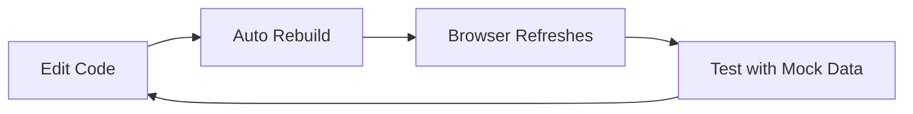
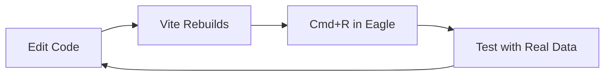
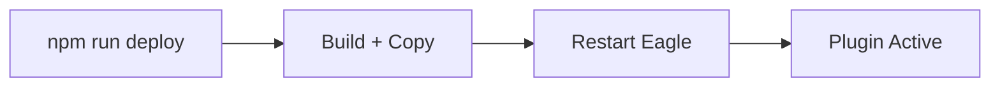

# Quick Start

Get your first Eagle plugin running in under 5 minutes. This guide covers two development workflows: browser-based and Eagle-based.

## Development Modes

The template supports two development modes:

| Mode | When to Use | Hot Reload | Real Data |
|------|-------------|------------|-----------|
| **Browser Dev** | Rapid iteration, UI work | ✅ Yes | ❌ Mock |
| **Eagle Watch** | Testing with real Eagle data | ⚠️ Manual reload | ✅ Yes |

## Browser Development (Recommended for UI)

The fastest way to iterate on your plugin's UI:

```bash
# Start the development server
npm run dev
```

Open [http://localhost:5173](http://localhost:5173) in your browser.

### What You'll See

The demo page includes 7 interactive tabs:

1. **Selection** — Eagle selection API demo
2. **Components** — Button, Card, Toast showcase
3. **Forms** — Input, Select, Checkbox, Slider
4. **Dialogs** — Dialog, DropdownMenu, Tooltip, Popover
5. **Canvas** — Canvas rendering demo
6. **Storage** — localStorage persistence
7. **Templates** — All 5 plugin templates

### Mock Eagle API

In browser mode, the Eagle API is mocked:

```tsx
import { eagleApi } from '@/lib/eagle-api';

// This returns mock data in browser
const items = await eagleApi.getSelectedItems();
console.log(items); // [{id: 'mock-1', name: 'Mock Image', ...}, ...]

// Check if using mock
console.log(eagleApi.isMock); // true in browser, false in Eagle
```

Configure mock data via URL parameters:

```
http://localhost:5173/?mockItems=50&mockPreset=largeLibrary
```

Or use the console API:

```javascript
window.mockEagle.preset('largeLibrary');  // 100 items, 20 folders
window.mockEagle.setConfig({ selectedItemCount: 10 });
```

## Eagle Watch Mode (Recommended for Integration)

Develop with real Eagle data while still getting fast rebuilds:

### Step 1: Start Watch Mode

```bash
npm run build:watch
```

This starts Vite in watch mode, rebuilding on every file change.

### Step 2: Import into Eagle

1. Open **Eagle** application
2. Go to **Settings → Plugins → Developer**
3. Click **Import Local Project**
4. Select your project's **root folder** (contains `manifest.json`)

### Step 3: Reload After Changes

After making code changes:

- **macOS**: Press `Cmd + R` in the plugin window
- **Windows**: Press `Ctrl + R` in the plugin window

:::tip Why Manual Reload?
Eagle caches plugin content. The `build:watch` command rebuilds instantly, but you need to reload the plugin to see changes.
:::

### Debugging in Eagle

Open DevTools in the plugin window:

- **macOS**: `Cmd + Option + I`
- **Windows**: `F12` or `Ctrl + Shift + I`

## Production Deployment

When you're ready to deploy:

```bash
npm run deploy
```

This command:
1. Builds the production bundle
2. Transforms `manifest.json` paths
3. Copies everything to Eagle's plugins directory

### Plugin Locations

| Platform | Path |
|----------|------|
| **macOS** | `~/Library/Application Support/Eagle/plugins/` |
| **Windows** | `%APPDATA%\Eagle\plugins\` |

### Activate the Plugin

After deployment:

1. **Restart Eagle** (or disable/enable the plugin)
2. Find your plugin in Eagle's plugin menu
3. Click to open

## Your First Modification

Let's make a simple change to verify everything works:

### 1. Edit the App Title

Open `src/App.tsx` and find the `Header` component:

```tsx
<Header
  title="My First Eagle Plugin"  // Change this
  showThemeToggle
/>
```

### 2. See It Update

- **Browser mode**: Save the file, page auto-refreshes
- **Eagle mode**: Save the file, press `Cmd/Ctrl + R`

### 3. Add a Button

```tsx
import { Button } from '@/components';

function App() {
  const handleClick = () => {
    console.log('Button clicked!');
  };

  return (
    <div>
      <Button variant="primary" onClick={handleClick}>
        Click Me!
      </Button>
    </div>
  );
}
```

## Common Workflows

### UI Development Flow



### Integration Testing Flow



### Production Flow



## Next Steps

Now that you have a working plugin:

1. **[Project Structure](./project-structure)** — Understand the file organization
2. **[Core Concepts](/docs/core-concepts/dual-environment)** — Learn the architecture
3. **[Components](/docs/components/overview)** — Explore UI components
