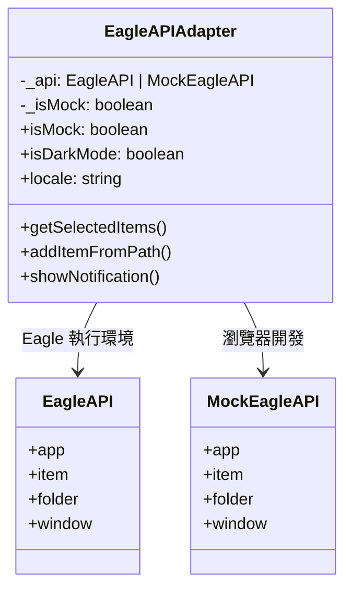

# Eagle API 適配器

`EagleAPIAdapter` 類別是雙環境模式的核心。它提供型別安全、統一的介面，在瀏覽器和 Eagle 中運作完全相同。

## 概覽

```typescript
import { eagleApi, isEagleEnvironment } from '@/lib/eagle-api';

// 單一匯入，隨處可用
const items = await eagleApi.getSelectedItems();
const isDark = eagleApi.isDarkMode;
const locale = eagleApi.locale;
```

## 架構



## 實作細節

### 建構函式模式

適配器在實例化時偵測環境：

```typescript
class EagleAPIAdapter {
  private _api: EagleAPI | Partial<EagleAPI>;
  private _isMock: boolean;

  constructor() {
    if (isEagleEnvironment()) {
      // 真實 Eagle API
      this._api = (window as EagleWindow).eagle;
      this._isMock = false;
    } else {
      // 瀏覽器開發用的模擬 API
      this._api = createMockEagleAPI();
      this._isMock = true;
    }
  }
}
```

### 安全的屬性取得器

屬性使用 try-catch 來處理 `plugin-create` 時序問題：

```typescript
// Eagle API 在 plugin-create 事件觸發前可能尚未完全初始化
get locale(): EagleLocale {
  try {
    return this._api.app?.locale || 'en';
  } catch {
    return 'en'; // 安全預設值
  }
}

get isDarkMode(): boolean {
  try {
    const darkThemes: EagleTheme[] = ['DARK', 'GRAY', 'BLUE', 'PURPLE'];
    if (this._api.app?.theme === 'Auto') {
      return this._api.app.isDarkColors?.() ?? false;
    }
    return darkThemes.includes(this._api.app.theme);
  } catch {
    // 回退到系統偏好
    return window.matchMedia('(prefers-color-scheme: dark)').matches;
  }
}
```

:::tip 為什麼使用 Try-Catch？
Eagle 的 API 屬性如果在 `plugin-create` 事件觸發前存取可能會拋出錯誤。try-catch 模式確保您的應用程式在模組載入期間可以安全地初始化 i18n 和主題。
:::

## API 參考

### 屬性

| 屬性 | 型別 | 描述 |
|----------|------|-------------|
| `isMock` | `boolean` | 瀏覽器中為 `true`，Eagle 中為 `false` |
| `isDarkMode` | `boolean` | 當前主題是否為深色 |
| `locale` | `EagleLocale` | 當前語言代碼 |
| `platform` | `string` | `'darwin'` 或 `'win32'` |
| `isMac` | `boolean` | 是否在 macOS 上執行 |
| `isWindows` | `boolean` | 是否在 Windows 上執行 |
| `version` | `string` | Eagle 版本（例如 `'4.0.0'`） |
| `build` | `number` | Eagle 建置編號 |

### 項目操作

```typescript
// 取得已選擇的項目
const items = await eagleApi.getSelectedItems();

// 取得資料庫中的所有項目
const allItems = await eagleApi.getAllItems();

// 依 ID 取得項目
const item = await eagleApi.getItemById('item-id');

// 新增項目到資料庫
await eagleApi.addItemFromPath('/path/to/image.png', {
  name: '我的圖片',
  tags: ['已處理', '已匯出'],
  annotation: '由我的外掛建立',
  folders: ['folder-id'],
});

// 從 URL 新增
await eagleApi.addItemFromURL('https://example.com/image.jpg', {
  name: '下載的圖片',
});
```

### 資料夾操作

```typescript
// 取得所有資料夾
const folders = await eagleApi.getAllFolders();

// 取得已選擇的資料夾
const selected = await eagleApi.getSelectedFolders();

// 依 ID 取得資料夾
const folder = await eagleApi.getFolderById('folder-id');

// 建立新資料夾
await eagleApi.createFolder({
  name: '新資料夾',
  parent: 'parent-folder-id', // 可選
});
```

### 視窗控制

```typescript
// 保持視窗置頂
await eagleApi.setAlwaysOnTop(true);

// 調整視窗大小
await eagleApi.setWindowSize(1200, 800);

// 取得視窗邊界
const bounds = await eagleApi.getWindowBounds();
```

### 對話框

```typescript
// 開啟檔案對話框
const result = await eagleApi.showOpenDialog({
  properties: ['openFile', 'multiSelections'],
  filters: [
    { name: '圖片', extensions: ['png', 'jpg', 'webp'] },
    { name: '所有檔案', extensions: ['*'] },
  ],
});

// 儲存檔案對話框
const savePath = await eagleApi.showSaveDialog({
  defaultPath: 'output.png',
  filters: [{ name: 'PNG 圖片', extensions: ['png'] }],
});

// 訊息框
await eagleApi.showMessageBox({
  type: 'info',
  title: '成功',
  message: '操作已完成！',
  buttons: ['確定'],
});
```

### 通知

```typescript
// 顯示通知
await eagleApi.showNotification('標題', '訊息內容');
```

### Shell 操作

```typescript
// 在預設瀏覽器中開啟 URL
await eagleApi.openExternal('https://eagle.cool');

// 在 Finder/檔案總管中顯示檔案
await eagleApi.showItemInFolder('/path/to/file.png');

// 使用預設應用程式開啟檔案
await eagleApi.openPath('/path/to/file.png');
```

### 日誌記錄

```typescript
// 在生產環境中寫入 Eagle 的日誌檔
eagleApi.log.info('處理開始');
eagleApi.log.warn('品質低於建議值');
eagleApi.log.error('儲存檔案失敗');
```

## 使用模式

### Async/Await 模式

```tsx
async function processSelection() {
  try {
    const items = await eagleApi.getSelectedItems();
    
    for (const item of items) {
      // 處理每個項目
      await processItem(item);
    }
    
    await eagleApi.showNotification('完成', `已處理 ${items.length} 個項目`);
  } catch (error) {
    eagleApi.log.error(`處理失敗：${error.message}`);
  }
}
```

### 搭配 React Hooks

```tsx
import { useEffect, useState } from 'react';
import { eagleApi } from '@/lib/eagle-api';

function useEagleItems() {
  const [items, setItems] = useState([]);
  const [loading, setLoading] = useState(true);

  useEffect(() => {
    eagleApi.getSelectedItems()
      .then(setItems)
      .finally(() => setLoading(false));
  }, []);

  return { items, loading };
}
```

### 條件渲染

```tsx
import { eagleApi } from '@/lib/eagle-api';

function FeatureGate({ children, fallback }) {
  if (eagleApi.isMock) {
    return fallback || <MockDataBanner />;
  }
  return children;
}

// 使用方式
<FeatureGate fallback={<p>此功能需要 Eagle</p>}>
  <RealExportButton />
</FeatureGate>
```

## 單例匯出

適配器以單例模式匯出：

```typescript
// src/lib/eagle-api.ts
export const eagleApi = new EagleAPIAdapter();
```

這確保了：
- **單一實例** — 無重複 API 連接
- **一致狀態** — 各處相同的模擬設定
- **可搖樹** — 只匯入您使用的部分

## 型別安全

完整的 TypeScript 支援與完整的 Eagle API 型別：

```typescript
import { eagleApi } from '@/lib/eagle-api';
import type { Item, Folder, EagleLocale } from '@/types/eagle';

// 型別安全的項目存取
const items: Item[] = await eagleApi.getSelectedItems();
const firstItem = items[0];

console.log(firstItem.id);        // string
console.log(firstItem.name);      // string
console.log(firstItem.tags);      // string[]
console.log(firstItem.filePath);  // string
```

## 下一步

- **[模擬系統](./mock-system)** — 設定測試用的模擬資料
- **[主題與 i18n](./theme-i18n)** — 與 Eagle 設定同步
- **[Eagle API 參考](/docs/eagle-api/overview)** — 完整 API 文件
