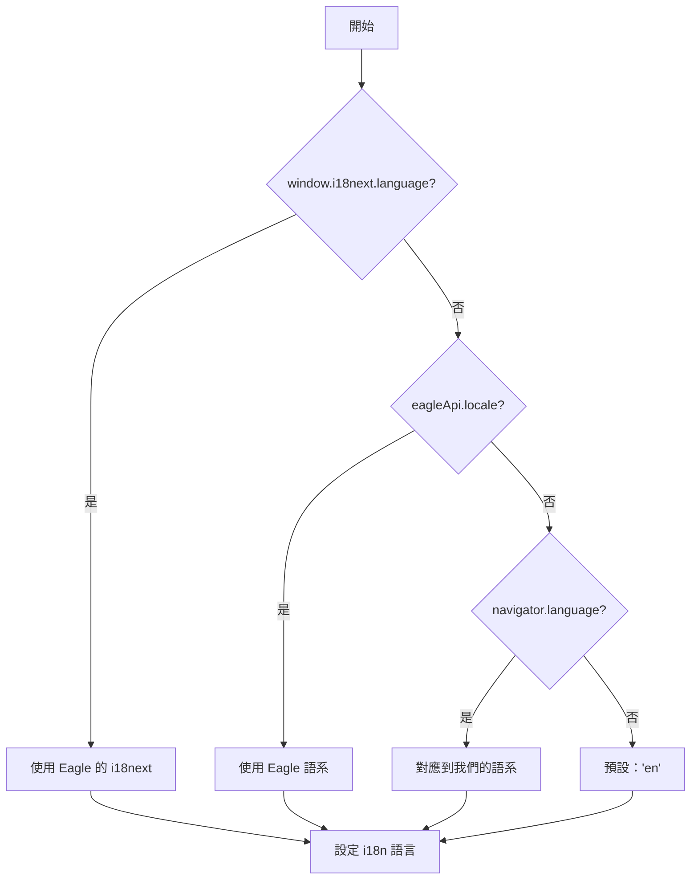

# 主題與 i18n

範本會自動與 Eagle 的主題和語言設定同步，提供原生體驗，同時保持完整的瀏覽器開發支援。

## 主題系統

### Eagle 主題

Eagle 支援以下主題模式：

| 主題 | 明暗度 | 描述 |
|-------|----------|-------------|
| `DARK` | 深色 | 純深色主題 |
| `LIGHT` | 淺色 | 純淺色主題 |
| `GRAY` | 深色 | 深灰色主題 |
| `BLUE` | 深色 | 深藍色強調 |
| `PURPLE` | 深色 | 深紫色強調 |
| `Auto` | 變化 | 跟隨系統偏好 |

### 主題偵測

`eagleApi.isDarkMode` 屬性計算當前的明暗度：

```typescript
import { eagleApi } from '@/lib/eagle-api';

// 在 Eagle 中：根據 Eagle 的主題設定計算
// 在瀏覽器中：使用系統偏好或 localStorage

if (eagleApi.isDarkMode) {
  // 套用深色樣式
}
```

### 實作

```typescript
// src/lib/eagle-api.ts
get isDarkMode(): boolean {
  try {
    const darkThemes: EagleTheme[] = ['DARK', 'GRAY', 'BLUE', 'PURPLE'];
    
    if (this._api.app?.theme === 'Auto') {
      // 對於 Auto 使用 Eagle 的計算值
      return this._api.app.isDarkColors?.() ?? false;
    }
    
    return darkThemes.includes(this._api.app.theme);
  } catch {
    // 回退到系統偏好
    return window.matchMedia('(prefers-color-scheme: dark)').matches;
  }
}
```

### useTheme Hook

對於 React 元件，使用 `useTheme` hook：

```tsx
import { useTheme } from '@/hooks';

function ThemeToggle() {
  const { theme, isDarkMode, setTheme, toggleTheme } = useTheme();

  return (
    <div>
      <p>當前：{theme}（{isDarkMode ? '深色' : '淺色'}）</p>
      
      <button onClick={toggleTheme}>
        切換主題
      </button>
      
      <select value={theme} onChange={(e) => setTheme(e.target.value)}>
        <option value="auto">自動</option>
        <option value="light">淺色</option>
        <option value="dark">深色</option>
      </select>
    </div>
  );
}
```

### 主題持久化

Hook 將使用者偏好儲存在 localStorage：

```typescript
// 儲存鍵值：'eagle-react-template:theme'

// 自動同步：
// 1. 檢查 localStorage 中已儲存的偏好
// 2. 將 'dark' class 套用到 <html> 元素
// 3. 監聽系統偏好變更
```

### Tailwind 整合

範本使用 Tailwind 的 `class` 策略深色模式：

```javascript
// tailwind.config.js
module.exports = {
  darkMode: 'class',
  // ...
};
```

在您的元件中使用深色模式 class：

```tsx
<div className="bg-white dark:bg-gray-900">
  <p className="text-gray-900 dark:text-gray-100">
    自動適應主題
  </p>
</div>
```

### CSS 變數

`globals.css` 中的 Eagle 專用設計標記：

```css
:root {
  /* 淺色主題 */
  --eagle-bg-primary: #ffffff;
  --eagle-text-primary: #1a1a1a;
  --eagle-accent-primary: #238636;
}

.dark {
  /* 深色主題 */
  --eagle-bg-primary: #0d1117;
  --eagle-text-primary: #c9d1d9;
  --eagle-accent-primary: #238636;
}
```

## 國際化（i18n）

### 8 種語言支援

預配置的翻譯：

| 代碼 | 語言 |
|------|----------|
| `en` | 英文（備用） |
| `zh_CN` | 簡體中文 |
| `zh_TW` | 繁體中文 |
| `ja_JP` | 日文 |
| `ko_KR` | 韓文 |
| `de_DE` | 德文 |
| `es_ES` | 西班牙文 |
| `ru_RU` | 俄文 |

### 語言偵測流程



### 使用翻譯

```tsx
import { useTranslation } from 'react-i18next';

function MyComponent() {
  const { t } = useTranslation();

  return (
    <div>
      <h1>{t('app.title')}</h1>
      <p>{t('demo.selectedCount', { count: 5 })}</p>
    </div>
  );
}
```

### 翻譯檔案結構

`_locales/en.json`：

```json
{
  "manifest": {
    "app": {
      "name": "Eagle React Template",
      "description": "Modern React template for Eagle plugins"
    }
  },
  "app": {
    "title": "Eagle React Template",
    "loading": "Loading..."
  },
  "demo": {
    "tabs": {
      "selection": "Selection",
      "components": "Components"
    },
    "selectedCount": "{{count}} items selected",
    "noSelection": "No items selected"
  },
  "common": {
    "save": "Save",
    "cancel": "Cancel",
    "confirm": "Confirm"
  }
}
```

### 複數形式

i18next 自動處理複數：

```json
{
  "item": "{{count}} item",
  "item_plural": "{{count}} items"
}
```

```tsx
t('item', { count: 1 });  // "1 item"
t('item', { count: 5 });  // "5 items"
```

### useLanguageSync Hook

自動與 Eagle 的語言變更同步：

```tsx
import { useLanguageSync } from '@/hooks';

function App() {
  // 同步時機：
  // - 外掛變為可見時
  // - Eagle 語言變更時
  // - html[lang] 屬性變更時
  useLanguageSync();

  return <MyApp />;
}
```

### 語言變更事件

Hook 監聽多個事件：

```typescript
// 監聽的事件：
// 1. visibilitychange - 當外掛標籤頁變為可見時
// 2. html[lang] 的 MutationObserver - 當 Eagle 變更語言時
// 3. 回退輪詢 - 每 10 秒（如果其他方法失敗）
```

### 新增語言

1. **建立翻譯檔案**：

```bash
cp _locales/en.json _locales/fr_FR.json
```

2. **翻譯所有鍵值**：

```json
{
  "app": {
    "title": "Modèle Eagle React"
  }
}
```

3. **新增到 manifest.json**：

```json
{
  "languages": ["en", "zh_CN", "zh_TW", "ja_JP", "ko_KR", "de_DE", "es_ES", "ru_RU", "fr_FR"],
  "fallbackLanguage": "en"
}
```

4. **新增到 i18n 設定**：

```typescript
// src/lib/i18n.ts
import fr_FR from '@locales/fr_FR.json';

const resources = {
  // ...現有的
  fr_FR: { translation: fr_FR },
};
```

## 瀏覽器與 Eagle 行為

| 面向 | 瀏覽器 | Eagle |
|--------|---------|-------|
| **主題** | 系統偏好 / localStorage | Eagle 的主題設定 |
| **語言** | navigator.language / localStorage | Eagle 的語系 |
| **主題變更** | 監聽 `prefers-color-scheme` | 監聽 Eagle 事件 |
| **語言變更** | 僅手動 | 自動與 Eagle 同步 |

## 最佳實踐

### 1. 始終使用翻譯鍵值

```tsx
// ❌ 寫死的文字
<button>Save</button>

// ✅ 翻譯鍵值
<button>{t('common.save')}</button>
```

### 2. 使用語意化顏色 Class

```tsx
// ❌ 固定顏色
<div className="bg-gray-900 text-white">

// ✅ 語意化 / 深色模式感知
<div className="bg-background text-foreground">
<div className="bg-white dark:bg-gray-900">
```

### 3. 處理缺失的翻譯

```tsx
// 如果翻譯缺失，i18next 會返回鍵值
// 在 i18n 設定中設定回退行為

i18n.init({
  fallbackLng: 'en',
  interpolation: {
    escapeValue: false, // React 已經轉義
  },
});
```

### 4. 測試多種語系

```javascript
// 在瀏覽器主控台中
window.mockEagle.setConfig({ locale: 'ja_JP' });
location.reload();
```

## 下一步

- **[元件](/docs/components/overview)** — UI 元件庫
- **[Hooks](/docs/hooks/overview)** — 自訂 React hooks
