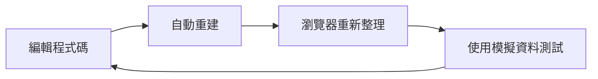
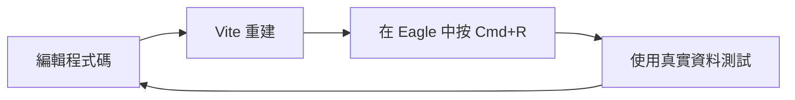
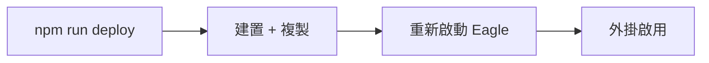

# 快速開始

在 5 分鐘內讓您的第一個 Eagle 外掛運行起來。本指南涵蓋兩種開發工作流程：瀏覽器模式和 Eagle 模式。

## 開發模式

範本支援兩種開發模式：

| 模式 | 使用時機 | 熱重載 | 真實資料 |
|------|-------------|------------|-----------|
| **瀏覽器開發** | 快速迭代、UI 開發 | ✅ 是 | ❌ 模擬 |
| **Eagle 監聽** | 使用真實 Eagle 資料測試 | ⚠️ 手動重載 | ✅ 是 |

## 瀏覽器開發（推薦用於 UI）

迭代外掛 UI 的最快方式：

```bash
# 啟動開發伺服器
npm run dev
```

在瀏覽器中開啟 [http://localhost:5173](http://localhost:5173)。

### 您將看到的內容

示範頁面包含 7 個互動式標籤頁：

1. **Selection** — Eagle 選擇 API 示範
2. **Components** — Button、Card、Toast 展示
3. **Forms** — Input、Select、Checkbox、Slider
4. **Dialogs** — Dialog、DropdownMenu、Tooltip、Popover
5. **Canvas** — Canvas 渲染示範
6. **Storage** — localStorage 持久化
7. **Templates** — 全部 5 個外掛範本

### 模擬 Eagle API

在瀏覽器模式中，Eagle API 是模擬的：

```tsx
import { eagleApi } from '@/lib/eagle-api';

// 在瀏覽器中返回模擬資料
const items = await eagleApi.getSelectedItems();
console.log(items); // [{id: 'mock-1', name: 'Mock Image', ...}, ...]

// 檢查是否使用模擬
console.log(eagleApi.isMock); // 瀏覽器中為 true，Eagle 中為 false
```

透過 URL 參數設定模擬資料：

```
http://localhost:5173/?mockItems=50&mockPreset=largeLibrary
```

或使用主控台 API：

```javascript
window.mockEagle.preset('largeLibrary');  // 100 個項目，20 個資料夾
window.mockEagle.setConfig({ selectedItemCount: 10 });
```

## Eagle 監聽模式（推薦用於整合）

使用真實 Eagle 資料開發，同時保持快速重建：

### 步驟 1：啟動監聽模式

```bash
npm run build:watch
```

這會以監聽模式啟動 Vite，在每次檔案變更時重新建置。

### 步驟 2：匯入到 Eagle

1. 開啟 **Eagle** 應用程式
2. 前往 **設定 → 外掛 → 開發者**
3. 點擊 **匯入本地專案**
4. 選擇您專案的 **根目錄**（包含 `manifest.json`）

### 步驟 3：變更後重新載入

修改程式碼後：

- **macOS**：在外掛視窗中按 `Cmd + R`
- **Windows**：在外掛視窗中按 `Ctrl + R`

:::tip 為什麼需要手動重載？
Eagle 會快取外掛內容。`build:watch` 指令會即時重建，但您需要重新載入外掛才能看到變更。
:::

### 在 Eagle 中偵錯

在外掛視窗中開啟 DevTools：

- **macOS**：`Cmd + Option + I`
- **Windows**：`F12` 或 `Ctrl + Shift + I`

## 生產部署

當您準備好部署時：

```bash
npm run deploy
```

此指令會：
1. 建置生產版本
2. 轉換 `manifest.json` 路徑
3. 複製所有內容到 Eagle 的外掛目錄

### 外掛位置

| 平台 | 路徑 |
|----------|------|
| **macOS** | `~/Library/Application Support/Eagle/plugins/` |
| **Windows** | `%APPDATA%\Eagle\plugins\` |

### 啟用外掛

部署後：

1. **重新啟動 Eagle**（或停用/啟用外掛）
2. 在 Eagle 的外掛選單中找到您的外掛
3. 點擊開啟

## 您的第一次修改

讓我們做一個簡單的修改來驗證一切正常運作：

### 1. 編輯應用程式標題

開啟 `src/App.tsx` 並找到 `Header` 元件：

```tsx
<Header
  title="我的第一個 Eagle 外掛"  // 修改這裡
  showThemeToggle
/>
```

### 2. 查看更新

- **瀏覽器模式**：儲存檔案，頁面自動重新整理
- **Eagle 模式**：儲存檔案，按 `Cmd/Ctrl + R`

### 3. 新增按鈕

```tsx
import { Button } from '@/components';

function App() {
  const handleClick = () => {
    console.log('按鈕被點擊了！');
  };

  return (
    <div>
      <Button variant="primary" onClick={handleClick}>
        點我！
      </Button>
    </div>
  );
}
```

## 常見工作流程

### UI 開發流程



### 整合測試流程



### 生產流程



## 下一步

現在您有了一個可運作的外掛：

1. **[專案結構](./project-structure)** — 了解檔案組織
2. **[核心概念](/docs/core-concepts/dual-environment)** — 學習架構設計
3. **[元件](/docs/components/overview)** — 探索 UI 元件
