<div align="center">

<a href="https://github.com/leonwong282/awesome-project-template">
  
</a>

# 🚀 Movie Picture Stitching - Eagle Plugin

> A modern, internationalized Eagle image management plugin for vertically stitching multiple movie images into panoramic compositions with full multilingual support

**🚀 MAJOR UPDATE (v3.0.0):** The plugin has been completely rewritten using **React 18 + TypeScript + Tailwind CSS** for a modern, maintainable codebase. This is a major architectural upgrade with improved performance, better developer experience, and enhanced UI components.


[🌍 English](README.md) | [🇹🇼 繁體中文](README.zh-TW.md) 

[Features](#-features) • [Installation](#-installation) • [Usage](#-usage) • [Development](#-development)

</div>

<a id="readme-top"></a>

## 📸 Preview

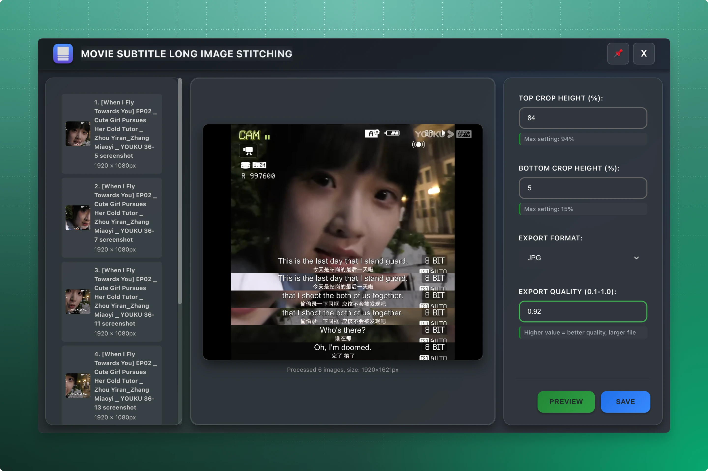
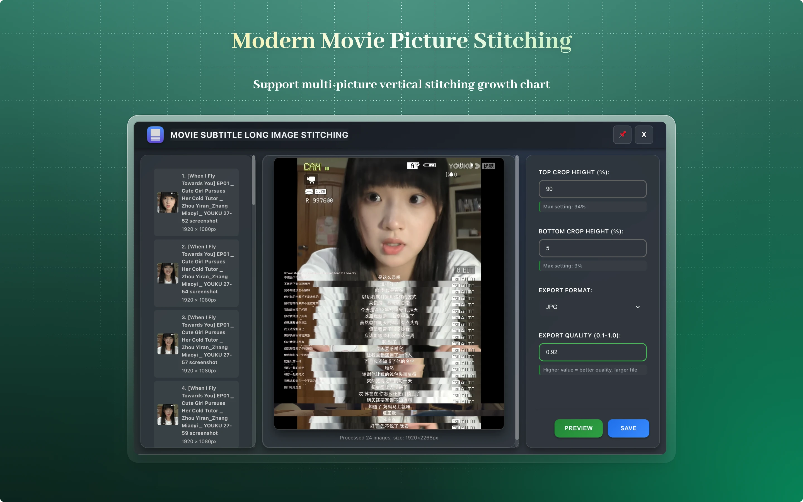
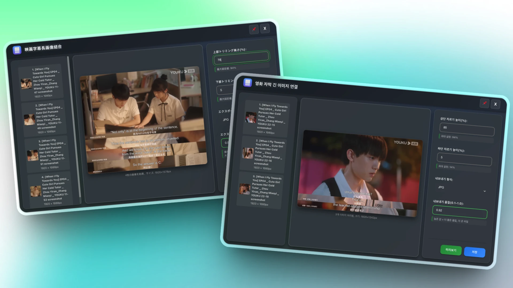

## ✨ Features

### 🎯 Core Functionality

- **Smart Stitching**: Vertically stitch multiple images into panoramic compositions
- **Precise Cropping**: Support top and bottom percentage-based cropping
- **Multi-format Export**: Output in JPG, WebP, PNG formats
- **Quality Control**: 0.1-1.0 precise quality adjustment
- **Real-time Preview**: High-performance Canvas rendering

### 🌍 Internationalization
- **8 Languages**: English, 简体中文, 繁體中文, 日本語, Español, Deutsch, 한국어, Русский
- **Auto Detection**: Automatically detects Eagle's language settings
- **Real-time Switching**: Dynamic language switching without restart
- **Localized Interface**: All UI elements fully translated

### 🎨 Modern React Interface
- **React 18 + TypeScript**: Fully type-safe component architecture with IntelliSense support
- **Tailwind CSS**: Utility-first styling with Eagle-specific design tokens and dark mode
- **Radix UI**: Accessible, unstyled component primitives (Dialog, Slider, Select, etc.)
- **Lucide Icons**: Beautiful, consistent iconography throughout the interface
- **Glass Morphism**: Modern frosted glass effects and smooth animations
- **Responsive Design**: Mobile-friendly layouts with Tailwind's responsive utilities

### 🚀 Advanced Features
- **Auto-Preview**: Automatically updates preview when images are reordered or parameters change
- **Parameter Persistence**: Automatically remembers your last settings across sessions
- **Keyboard Shortcuts**: Full keyboard navigation support (Cmd/Ctrl + Enter for preview, etc.)
- **Lightbox Viewer**: Full-screen image viewer with zoom and pan controls
- **Drag & Drop Reordering**: Intuitive image order management
- **Parameter Validation**: Smart parameter adjustment preventing invalid inputs
- **Error Handling**: Comprehensive error catching with user-friendly messages
- **Resource Management**: Automatic cleanup of temporary files and memory
- **Performance Optimization**: Parallel image loading with debounced processing
- **Always On Top**: Pin window option for better workflow
- **State Management**: Zustand-powered state management for reliable data flow

## 🛠 Installation

### Method 1: Direct Installation

1. Download the plugin package
2. Open `Settings` → `Plugins` → `Plugins Center` in Eagle
3. Click `Install Plugin`
4. Enable the plugin

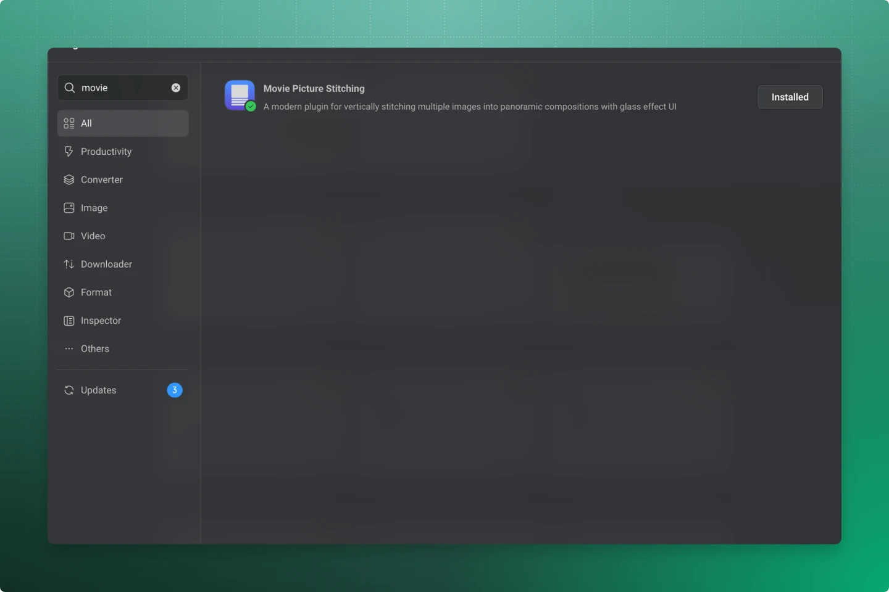

### Method 2: Development Installation
1. Download the plugin package
2. Open `Settings` → `Plugins` → `Developer` in Eagle
3. Click `Import Local Project`
4. Select the plugin folder `Movie Picture Stitching`
5. Enable the plugin

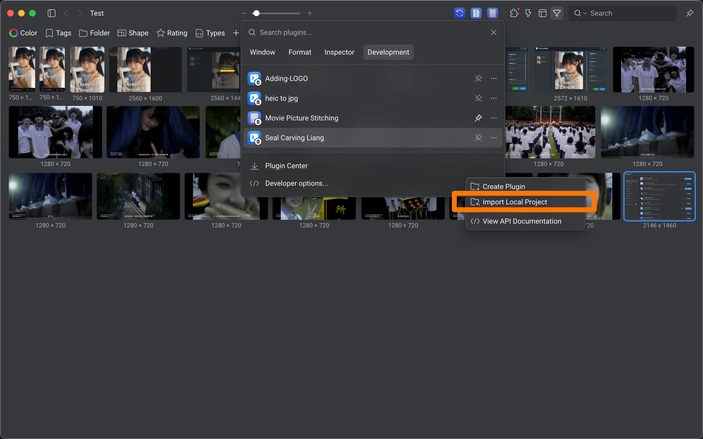

## 🎯 Usage

1. **Select Images**: Select 2 or more images in Eagle that you want to stitch together
2. **Open Plugin**: Right-click to open the context menu and click "Movie Picture Stitching"
3. **Configure Parameters**:
   - **Top Crop**: Set the percentage to crop from the top (0-90%)
   - **Bottom Crop**: Set the percentage to crop from the bottom (0-90%)
   - **Quality**: Adjust output quality (0.1-1.0, applies to JPG and WebP formats)
   - **Format**: Choose output format (JPG, WebP, PNG)
4. **Real-time Preview**: The plugin provides real-time preview as you adjust parameters
5. **Save Result**: Click the "Save Image" button to export the stitched image

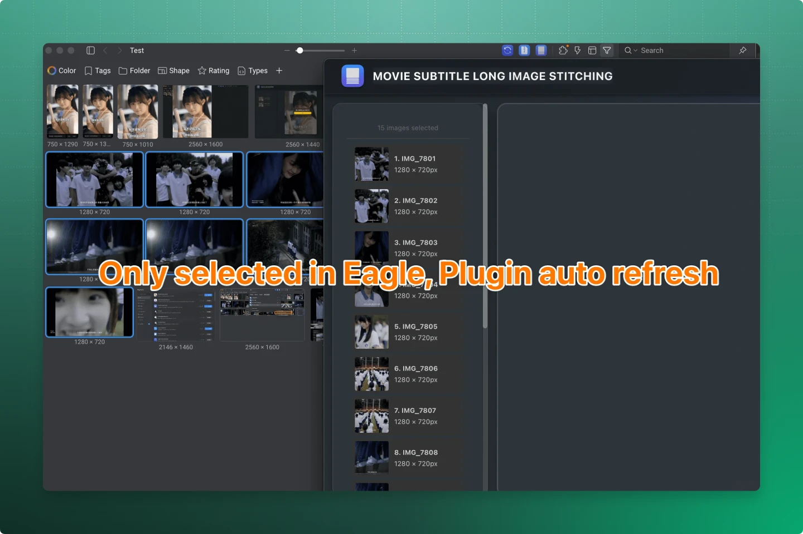
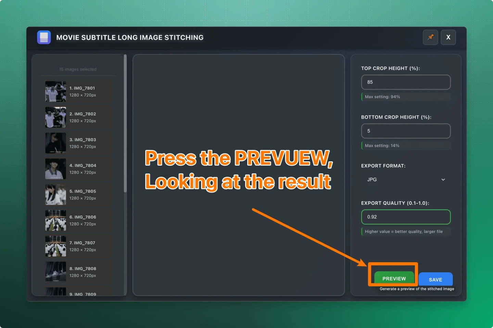
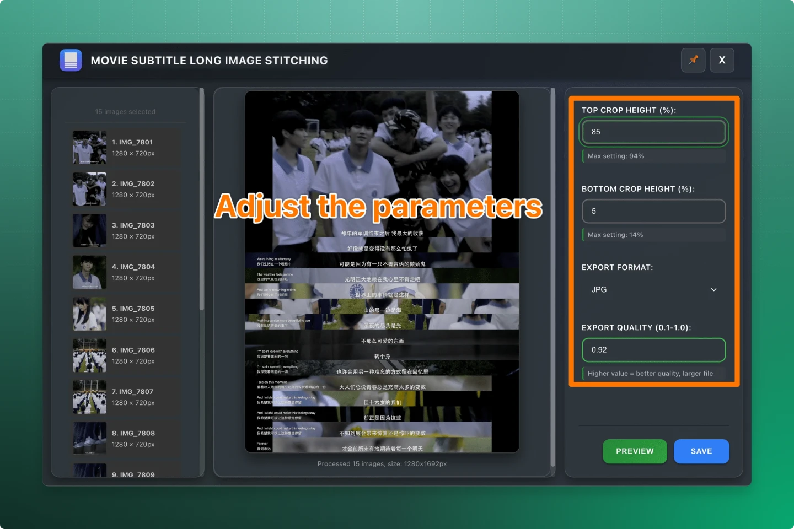
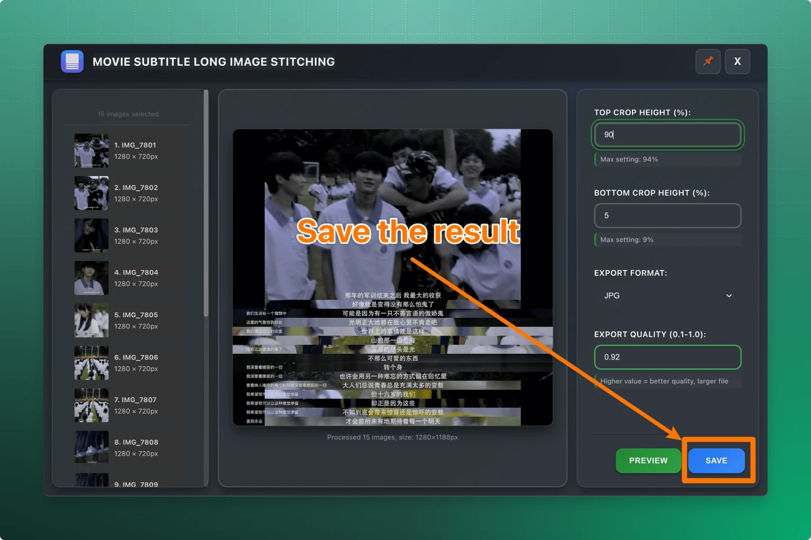
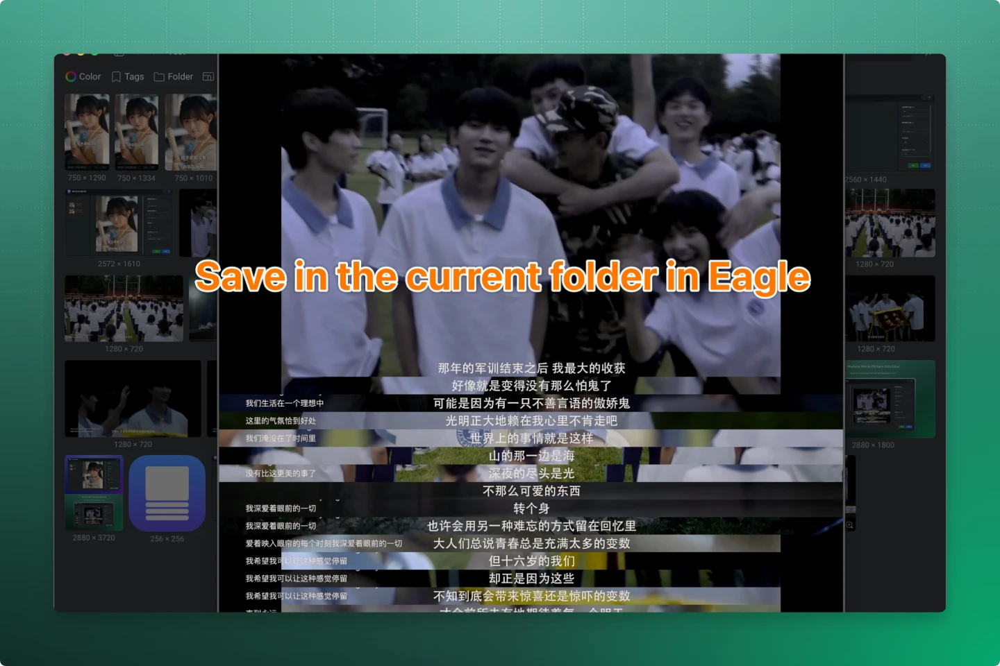


### 🌍 Language Support

The plugin automatically detects your Eagle language settings and switches to the corresponding interface language. Currently supported languages:

- **English** (en)
- **简体中文** (zh_CN) 
- **繁體中文** (zh_TW)
- **日本語** (ja_JP)
- **Español** (es_ES)
- **Deutsch** (de_DE)
- **한국어** (ko_KR)
- **Русский** (ru_RU)

### 💡 Pro Tips

- **Auto-Preview**: Enable auto-preview in settings to automatically update the preview when you reorder images or change parameters
- **Keyboard Shortcuts**: 
  - `Cmd/Ctrl + Enter`: Generate preview
  - `Cmd/Ctrl + S`: Save image
  - `Cmd/Ctrl + H`: Show keyboard shortcuts help
  - `Cmd/Ctrl + 1/2`: Focus crop input fields
- **Settings Memory**: Your parameters (crop percentages, format, quality, auto-preview) are automatically saved and restored when you reopen the plugin
- **Lightbox Viewer**: Click the preview image to open full-screen viewer with zoom and pan controls
- **Drag & Drop**: Reorder images by dragging them in the left panel
- **Cropping Guidelines**: Keep total crop percentage (top + bottom) under 80% for best results
- **Quality Balance**: Use 0.8-0.9 quality for optimal file size vs image quality balance
- **Format Selection**: 
  - Use JPG for photos with many colors
  - Use WebP for smaller file sizes with good quality
  - Use PNG for images requiring transparency or lossless compression
- **Performance**: For large images, the plugin automatically optimizes processing for smooth operation

### 📊 Parameter Guide
- **Top Cropping**: Affects all images except the first one, crops specified percentage from top
- **Bottom Cropping**: Affects all images, crops specified percentage from bottom  
- **Export Format**: 
  - `JPG`: Best for photographs with many colors, smaller file size
  - `WebP`: Modern format with excellent compression, balanced quality and size
  - `PNG`: Lossless format, ideal for graphics and images requiring transparency
- **Export Quality**: Range 0.1-1.0, higher values mean better quality but larger files

### 🎯 Usage Tips
- 💡 **Smart Validation**: System automatically displays valid parameter ranges
- 💡 **Cropping Limits**: Total cropping (top + bottom) cannot exceed 99%
- 💡 **Live Preview**: Preview updates in real-time as you adjust parameters
- 💡 **Performance**: Recommended to process maximum 50 images per batch for optimal performance
- 💡 **Memory Management**: Plugin automatically optimizes memory usage for large images

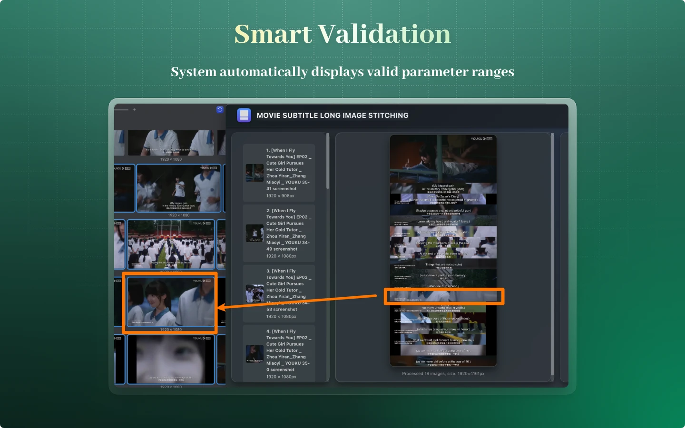
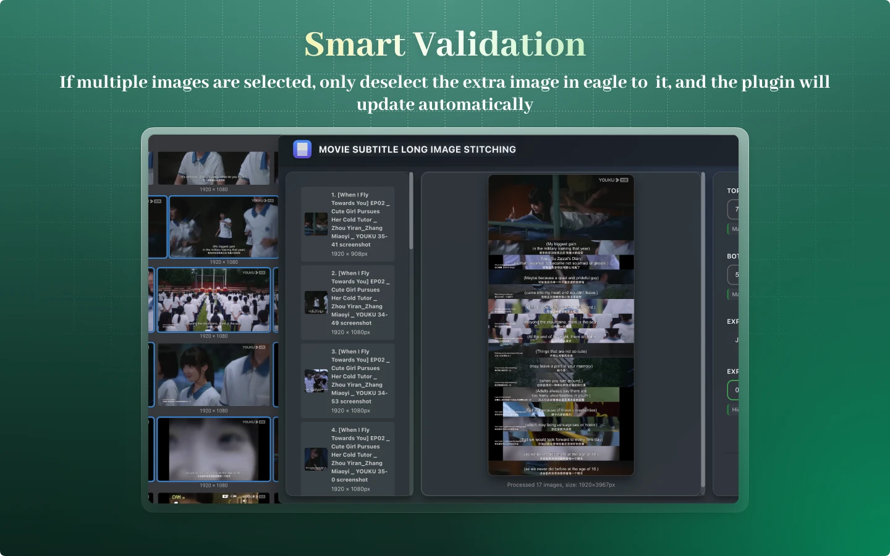
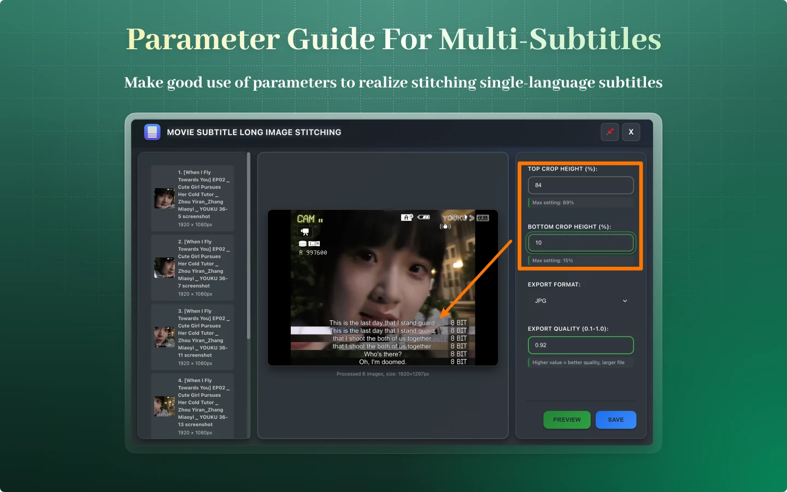
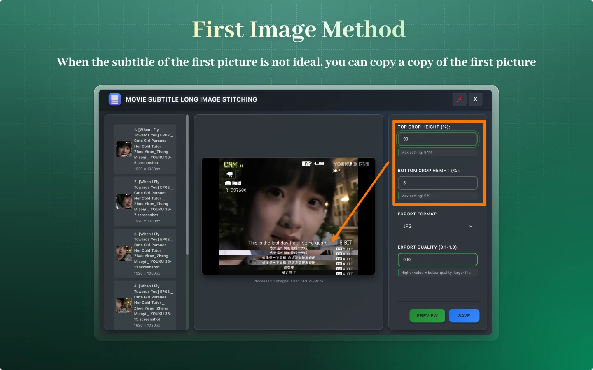
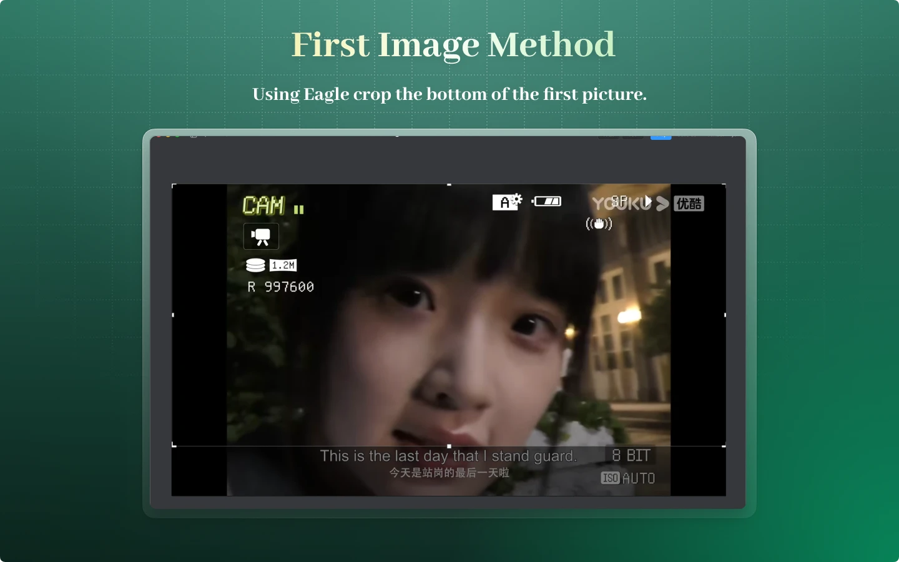
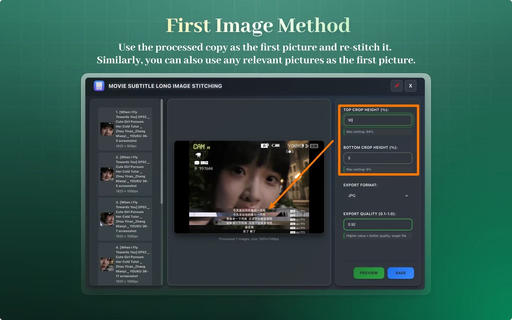

## 🛠️ Development

### Prerequisites
- **Node.js** 18+ and npm/yarn/pnpm
- **Eagle** 4.0 or higher
- **Modern web browser** with Canvas API support (for development)
- Basic understanding of **React**, **TypeScript**, and **Tailwind CSS**

### Project Structure (React + TypeScript)
```
eagle-movie-picture-stitching/
├── LICENSE                                    # GPL-3.0 license
├── README.md                                  # English documentation
├── README.zh-TW.md                            # Traditional Chinese documentation
├── CHANGELOG.md                               # Version history
├── Movie Picture Stitching/                  # Legacy plugin (Bootstrap 5 version)
│   └── ...                                    # Original implementation
├── Movie Picture Stitching React/            # ⭐ New React-based plugin
│   ├── manifest.json                         # Plugin configuration
│   ├── index.html                            # Entry point
│   ├── package.json                          # Dependencies and scripts
│   ├── vite.config.ts                        # Vite build configuration
│   ├── tailwind.config.js                    # Tailwind CSS configuration
│   ├── tsconfig.json                         # TypeScript configuration
│   ├── _locales/                             # Internationalization (8 languages)
│   │   ├── en.json
│   │   ├── zh_CN.json
│   │   ├── zh_TW.json
│   │   └── ...
│   ├── src/
│   │   ├── main.tsx                          # Application entry point
│   │   ├── App.tsx                           # Root component
│   │   ├── pages/
│   │   │   └── StitchingPage.tsx            # Main stitching interface
│   │   ├── components/
│   │   │   ├── stitching/                   # Stitching-specific components
│   │   │   │   ├── ImageQueue.tsx           # Image list with drag-drop
│   │   │   │   ├── ParameterPanel.tsx      # Settings panel
│   │   │   │   ├── PreviewCanvas.tsx        # Preview display
│   │   │   │   ├── LightboxDialog.tsx       # Full-screen viewer
│   │   │   │   └── ShortcutsDialog.tsx      # Keyboard shortcuts help
│   │   │   └── ui/                          # Reusable UI components
│   │   │       ├── Button.tsx
│   │   │       ├── Dialog.tsx
│   │   │       ├── Slider.tsx
│   │   │       └── ...
│   │   ├── hooks/                           # Custom React hooks
│   │   │   ├── useEagleSelection.ts         # Track selected items
│   │   │   ├── useKeyboardShortcuts.ts      # Keyboard shortcuts
│   │   │   ├── useTheme.ts                  # Theme management
│   │   │   └── ...
│   │   ├── stores/                          # Zustand state management
│   │   │   ├── index.ts                     # Store configuration
│   │   │   └── slices/                      # Feature slices
│   │   │       ├── stitching.ts             # Stitching state
│   │   │       ├── settings.ts              # User settings
│   │   │       └── ...
│   │   ├── lib/                             # Core utilities
│   │   │   ├── eagle-api.ts                 # Eagle API adapter
│   │   │   ├── stitching-engine.ts          # Image stitching logic
│   │   │   ├── i18n.ts                      # i18next configuration
│   │   │   └── ...
│   │   ├── templates/                       # Layout templates
│   │   │   └── ThreeColumnTemplate.tsx      # Main layout
│   │   └── styles/
│   │       └── globals.css                  # Global styles + Tailwind
│   └── dist/                                # Built output (deployed to Eagle)
├── images/                                  # Documentation assets
└── screenshots/                             # Plugin screenshots
```

### 🌍 Internationalization Development

The plugin features a comprehensive i18n system supporting 8 languages:

**Language Files Structure:**
```
_locales/
├── en.json       # English (base language)
├── zh_CN.json    # Simplified Chinese
├── zh_TW.json    # Traditional Chinese
├── ja_JP.json    # Japanese
├── es_ES.json    # Spanish
├── de_DE.json    # German
├── ko_KR.json    # Korean
└── ru_RU.json    # Russian
```

**Key i18n Features:**
- Automatic language detection based on Eagle settings
- Real-time UI language switching without restart
- Comprehensive error message localization
- Cultural formatting for numbers and dates

### Local Development

1. **Clone Repository**:
   ```bash
   git clone https://github.com/leonwong282/eagle-movie-picture-stitching.git
   cd eagle-movie-picture-stitching
   ```

2. **Install Dependencies**:
   ```bash
   cd "Movie Picture Stitching React"
   npm install
   ```

3. **Development Mode** (Browser with mocked API):
   ```bash
   npm run dev
   # Opens browser at http://localhost:5173
   # Hot reload enabled - edit code and see changes instantly
   ```

4. **Build for Production**:
   ```bash
   npm run build
   # Outputs optimized bundle to dist/ folder
   ```

5. **Deploy to Eagle**:
   ```bash
   npm run deploy
   # Copies dist/ to Eagle's plugin directory
   # Or manually copy dist/ contents to Eagle plugin folder
   ```

6. **Testing**:
   ```bash
   npm run test          # Run unit tests
   npm run test:e2e      # Run end-to-end tests
   npm run test:visual  # Visual regression tests
   ```

7. **Code Quality**:
   ```bash
   npm run lint          # Check for linting errors
   npm run lint:fix      # Auto-fix linting issues
   npm run format        # Format code with Prettier
   npm run typecheck     # TypeScript type checking
   ```

### React Component Examples

**Using Eagle API:**
```typescript
import { eagleApi } from '@/lib/eagle-api';
import { useEagleSelection } from '@/hooks/useEagleSelection';

function MyComponent() {
  const { selectedItems, isLoading } = useEagleSelection();
  
  const handleSave = async () => {
    const items = await eagleApi.getSelectedItems();
    // Process items...
  };
  
  return <div>{/* UI */}</div>;
}
```

**State Management with Zustand:**
```typescript
import { useStitching } from '@/stores';

function ParameterPanel() {
  const { cropTop, cropBottom, setCropTop, setCropBottom } = useStitching();
  
  return (
    <Slider
      value={[cropTop]}
      onValueChange={([value]) => setCropTop(value)}
    />
  );
}
```

**Internationalization:**
```typescript
import { useTranslation } from 'react-i18next';

function MyComponent() {
  const { t } = useTranslation();
  
  return <h1>{t('ui.title', 'Default Title')}</h1>;
}
```

**Keyboard Shortcuts:**
```typescript
import { useKeyboardShortcuts } from '@/hooks/useKeyboardShortcuts';

function MyComponent() {
  useKeyboardShortcuts({
    preview: () => handlePreview(),
    save: () => handleSave(),
  });
  
  return <div>{/* UI */}</div>;
}
```

### Tech Stack
- **Frontend Framework**: React 18.3 + TypeScript 5.6
- **Build Tool**: Vite 5 (lightning-fast HMR and optimized builds)
- **Styling**: Tailwind CSS 3 + CSS Variables (Eagle design tokens)
- **UI Components**: Radix UI (accessible primitives) + Lucide Icons
- **State Management**: Zustand 5 (lightweight, performant)
- **Internationalization**: i18next + react-i18next (8 languages)
- **Image Processing**: Canvas API with optimized rendering
- **File Operations**: Node.js fs, path modules (Eagle environment)
- **Testing**: Vitest (unit tests) + Playwright (E2E tests)
- **Code Quality**: ESLint + Prettier + TypeScript strict mode

### Development Workflow

**Browser Development (Hot Reload):**
```bash
cd "Movie Picture Stitching React"
npm install
npm run dev
# Opens browser with mocked Eagle API
# Edit code → See changes instantly
```

**Build for Production:**
```bash
npm run build
# Outputs to dist/ folder
# Deploy to Eagle using deploy script
```

**Testing:**
```bash
npm run test          # Unit tests
npm run test:e2e      # End-to-end tests
npm run test:visual  # Visual regression tests
```

### Architecture Highlights

**Dual Environment Pattern:**
- Develop in browser with mocked Eagle API (fast iteration)
- Deploy to Eagle with real API (seamless transition)
- Same codebase works in both environments

**Component-Based Design:**
- Reusable UI components with TypeScript types
- Composition over inheritance
- Props-based configuration

**State Management:**
- Zustand slices for feature isolation
- Type-safe state updates
- Optimized re-renders with selectors

## 🐛 Troubleshooting

### Common Issues

**Q: Plugin won't start**
- Check if Eagle version supports plugins (requires 4.0+)
- Verify plugin file integrity
- Check error messages in Eagle plugin management page

**Q: Image stitching fails**
- Confirm selected files are valid image formats
- Check if image count is too high (recommend <50 images)
- Verify parameter settings are reasonable

**Q: Preview display issues**
- Refresh plugin page and retry
- Check if image dimensions are too large
- Confirm browser supports Canvas functionality

**Q: Interface display issues**
- Clear browser cache
- Check CSS file integrity
- Confirm browser supports modern CSS features

**Q: Language not switching**
- Verify Eagle language settings match desired language
- Check if language file exists in `_locales/` folder
- Restart plugin to reload language settings

### Performance Optimization Tips
- Keep image count under 50 per batch for optimal performance
- Use JPG format to reduce memory usage
- Avoid processing ultra-high resolution images (>4K)
- Restart plugin periodically to free memory
- Close other resource-intensive applications during large batch processing

### Language Support Issues
- **Missing translations**: Some text may fall back to English if translations are incomplete
- **Cultural formatting**: Numbers and formats automatically adapt to selected language
- **RTL languages**: Currently optimized for LTR languages; RTL support planned for future versions

## 📋 Changelog

### v3.0.0 (2025-01-XX) 🚀 React Rewrite
- **🚀 Complete React Rewrite**: Full migration to React 18 + TypeScript
  - Modern component architecture with hooks
  - Type-safe development with full IntelliSense
  - Improved performance and maintainability
- **🎨 UI Overhaul**: 
  - Tailwind CSS utility-first styling
  - Radix UI accessible components
  - Lucide icons for consistent iconography
  - Enhanced dark mode support
- **✨ New Features**:
  - Auto-preview on parameter changes
  - Keyboard shortcuts support (Cmd/Ctrl + H for help, etc.)
  - Lightbox full-screen viewer with zoom/pan
  - Drag & drop image reordering
  - Improved parameter persistence
- **🛠 Developer Experience**:
  - Vite for lightning-fast HMR
  - Browser-based development with mocked API
  - Comprehensive test suite
  - Better error handling and debugging

### v2.0.0 (2024-XX-XX) 🎨 Bootstrap 5
- **🎨 Bootstrap 5 Migration**: UI rebuilt with Bootstrap 5
- **📦 Modular CSS**: Component-based stylesheet architecture

### v1.0.0 (2025-09-01) 🌍
- **🌍 Full Internationalization**: Complete 8-language support system
  - English, 简体中文, 繁體中文, 日本語, Español, Deutsch, 한국어, Русский
  - Automatic Eagle language detection
  - Real-time language switching
  - Localized error messages and UI elements

## 📄 License

This project is licensed under the [GPL-3.0 License](LICENSE).

## 🙏 Acknowledgments

- [Eagle](https://eagle.cool/) - Outstanding image management and organization software
- Community contributors for valuable feedback and suggestions
- International users for helping with translations and localization
- All users who support the development of this plugin

## 📞 Contact & Support

- **Project Homepage**: [GitHub Repository](https://github.com/leonwong282/eagle-movie-picture-stitching)
- **Bug Reports**: [Issues](https://github.com/leonwong282/eagle-movie-picture-stitching/issues)
- **Feature Requests**: [Discussions](https://github.com/leonwong282/eagle-movie-picture-stitching/discussions)
- **Documentation**: [Wiki](https://github.com/leonwong282/eagle-movie-picture-stitching/wiki)

---

<div align="center">

**If this plugin helps you, please give it a ⭐ Star!**

Made with ❤️ for the Eagle community

*Supporting Eagle's mission to make digital asset management effortless*

</div>

<p align="right">(<a href="#readme-top">back to top</a>)</p>
